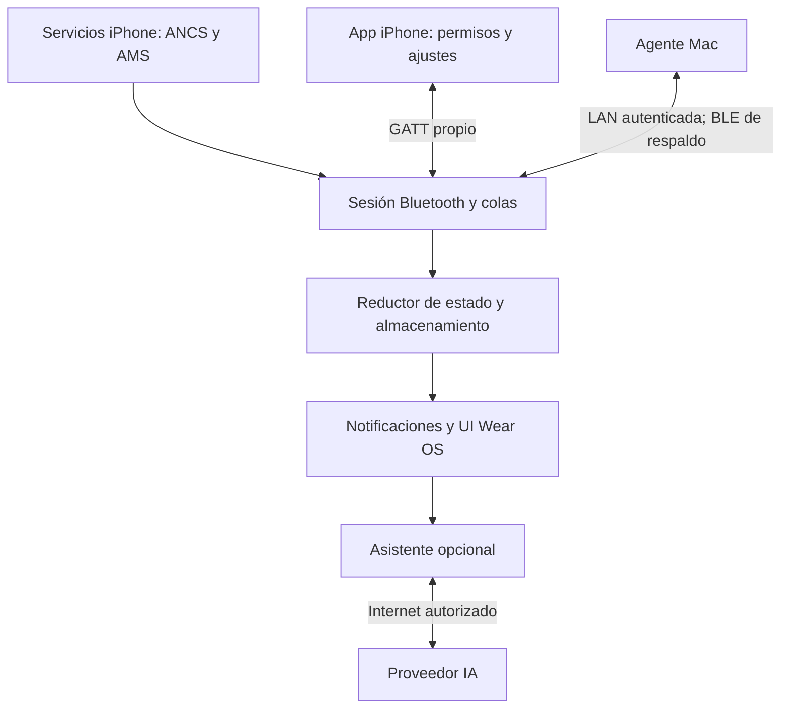
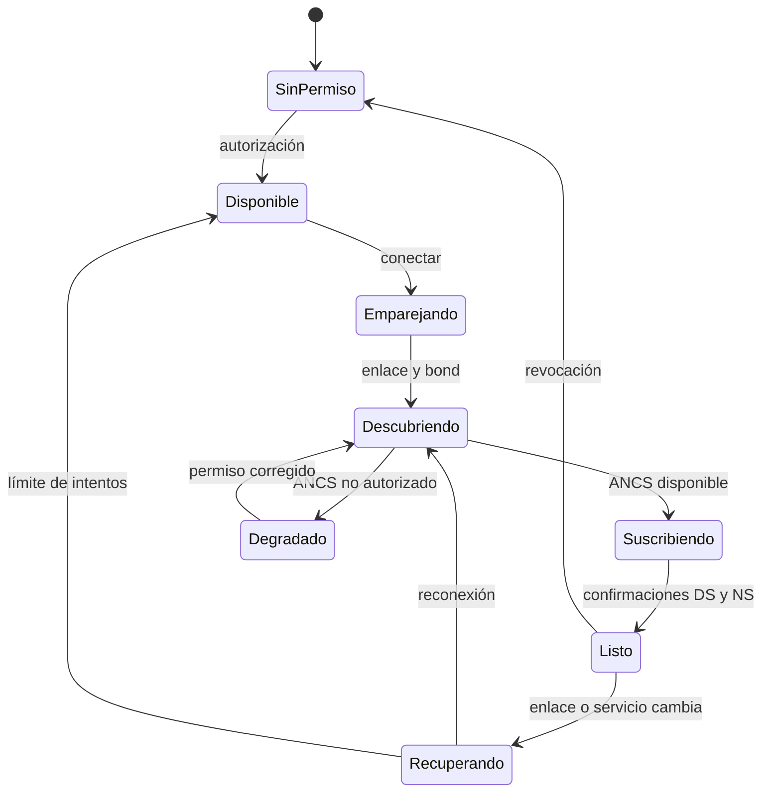
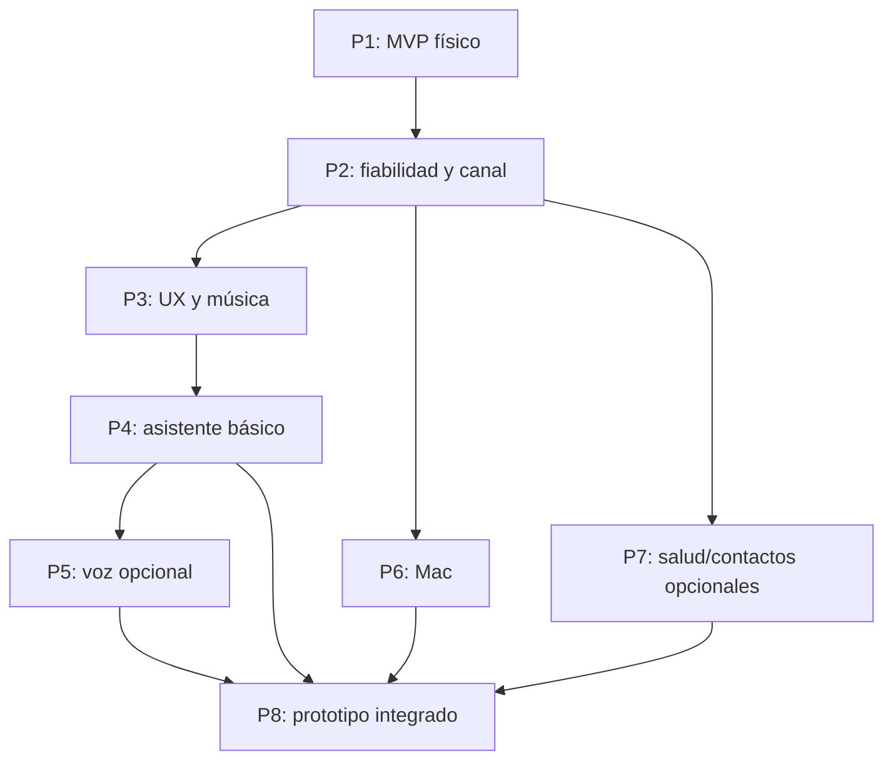

# Plan de ejecución: Galaxy Watch7 con iPhone, Mac y asistente de IA

Versión del plan: 1.0 · Revalidado el 16 de octubre de 2026 · Estado: listo para iniciar implementación, sujeto a las pruebas físicas indicadas.

Dispositivos iniciales: iPhone 15 actualizado y Galaxy Watch7 ya configurado. Plataforma adicional: Mac, en una fase posterior. Nombre provisional del proyecto: **WristBridge**; cambiarlo no afecta la arquitectura.

Este documento desarrolla la investigación `galaxy_apple_investigacion_arquitectura.md`. Es un plan de ingeniería y validación; no certifica que ya exista una aplicación funcional ni que se hayan ejecutado las pruebas propuestas.

## Índice

1. Resultado esperado y alcance.
2. Fuentes revalidadas y grado de evidencia.
3. Repositorios: decisiones de reutilización y exclusión.
4. Arquitectura y decisiones técnicas.
5. Requisitos funcionales y de calidad.
6. Fase 1: MVP de notificaciones directas.
7. Fase 2: fiabilidad, seguridad y protocolo de aplicación.
8. Fase 3: experiencia nativa y controles multimedia.
9. Fase 4: asistente de texto y dictado.
10. Fase 5: voz en tiempo real.
11. Fase 6: integración con Mac.
12. Fase 7: salud, contactos y extensiones.
13. Fase 8: prototipo integrado y preparación de distribución.
14. Estrategia de pruebas y medición.
15. Catálogo ejecutable de pruebas.
16. CI, artefactos y entornos.
17. Organización del trabajo y dependencias.
18. Riesgos, decisiones y alternativas.
19. Aceptación final y siguientes tareas.
20. Referencias primarias.

## 1. Resultado esperado y alcance

### 1.1 Qué tendrá el prototipo final

Dos aplicaciones nativas que conectan directamente iPhone y Watch7. El reloj recibe avisos del teléfono mediante ANCS, mantiene las tarjetas actualizadas, expone las acciones realmente disponibles y controla reproducción mediante AMS. La app del iPhone facilita onboarding, permisos, ajustes y diagnóstico.

El asistente se abre con un acceso breve desde el reloj: pregunta escrita o dictada, respuesta progresiva y lectura opcional. La voz continua se desarrolla después, con conectividad y credenciales propias de ese servicio. El agente Mac envía alertas de integraciones seleccionadas y ejecuta acciones autorizadas en la laptop. Salud y contactos son extensiones optativas y separadas.

**Sin intermediario** significa que las notificaciones del iPhone llegan al reloj por Bluetooth sin un teléfono Android, un servidor o una Mac de relevo. Una consulta a un modelo remoto sí requiere Internet; ese requisito no modifica el enlace local de notificaciones. El prototipo no depende de que la Mac esté encendida para usar el reloj con el iPhone.

### 1.2 Qué debe demostrar la primera fase

Un usuario instala las dos apps, autoriza el accesorio, recibe un aviso real, ve una actualización sin duplicados y observa su eliminación. Después bloquea el iPhone, deja dormir la pantalla del reloj y continúa recibiendo avisos. Si sale del alcance y regresa, el sistema recupera una sesión útil sin reinstalar ni restablecer de fábrica.

La fase 1 incluye una prueba técnica temprana de viabilidad y luego el MVP completo; no se crea una fase previa que oculte el riesgo principal.

### 1.3 Funciones que no condicionarán el MVP

- Activación inicial de un Watch7 nuevo desde iOS: no implementada por los puentes estudiados.
- Responder libremente cualquier WhatsApp, SMS o iMessage: ANCS no ofrece esa API universal.
- Audio de llamadas telefónicas: requiere investigación de perfiles Bluetooth y capacidades OEM independiente de las alertas.
- Acceso automático al historial existente de ChatGPT.
- Captura universal de las notificaciones de todas las apps de macOS.
- Igualdad total con Apple Watch, sincronización de Apple Pay, desbloqueo de Mac o funciones privadas del ecosistema.

Esas capacidades solo se añaden con una vía pública y una prueba explícita. No se muestra un control que aparente una función inexistente.

### 1.4 Restricciones iniciales

1. El reloj conserva su configuración actual. No se usa un reinicio de fábrica como procedimiento rutinario de desarrollo.
2. Se necesitan acceso físico al iPhone y reloj y una Mac con Xcode para compilar/firmar iOS. Android Studio/SDK pueden usarse en Mac, Windows o Linux.
3. Credenciales Apple y claves de firma pertenecen al usuario; no se copian las de los repositorios originales.
4. Primero México y APIs disponibles allí. La ruta moderna Accessory Notifications con restricciones de la UE no será una dependencia central [F08].
5. No hay cambios de firmware, root ni jailbreak en el plan base.
6. La reproducción del protocolo se valida primero sin datos de trabajo o conversaciones reales: fixtures y notificaciones sintéticas.

## 2. Fuentes revalidadas y grado de evidencia

### 2.1 Qué se comprobó nuevamente

Se leyó la versión actual del informe anterior. Se consultó el HEAD remoto de los ocho repositorios: todos conservan los commits listados en la sección 3. Se revisaron otra vez parsers ANCS, comandos, colas, manifiestos, pruebas, restauración y deduplicación de salud. Se revisaron fuentes oficiales de Apple, Google/Android y OpenAI; los enlaces están en la sección 20.

La revisión sigue siendo estática, dirigida a las rutas críticas. No es una certificación completa de cada dependencia. La ejecución anterior de pruebas quedó bloqueada antes de iniciar por la descarga de Gradle. No se repitió la misma descarga sin un cambio de entorno. Este plan no etiqueta ninguna prueba de hardware como aprobada.

### 2.2 Etiquetas de evidencia

| Etiqueta | Significado | Uso en decisiones |
|---|---|---|
| D | Comportamiento publicado en documentación primaria | Define formatos y límites de plataforma. |
| C | Comportamiento observado en código de una revisión fijada | Permite identificar patrones y riesgos; no prueba ejecución. |
| H | Comportamiento medido en hardware propio | Necesario para declarar compatibilidad. Actualmente pendiente. |
| P | Decisión o objetivo propuesto por este plan | Se valida durante implementación; no es una garantía del proveedor. |
| X | Investigación condicionada a resultado | No bloquea las funciones básicas salvo que se indique. |

La versión de una plataforma, su SDK y el firmware de una variante de reloj son datos distintos. No confundir «Galaxy Watch7» con «Wear OS 7».

### 2.3 Política de versiones

- Referencia actual del iPhone usada en la investigación: iOS 27.0.1 según el registro oficial consultado [F01]. Antes de probar, registrar versión y build realmente instalados.
- Wear OS 7 / API 37 como objetivo de compatibilidad actual y Wear OS 6 / API 36 como cobertura adicional. El historial oficial consultado para SM-L310 todavía publica Wear OS 6 / One UI 8; no demuestra el rollout de todas las regiones [F02–F03].
- Para el MVP, proponer `minSdk=35`, sujeto a confirmar el Watch7; ampliar hacia abajo solo con una necesidad y hardware de prueba. El `compileSdk/targetSdk` se fija en la última plataforma estable compatible con la cadena de herramientas al abrir P1-02; no copiar valores viejos de un fork.
- App iOS: deployment mínimo propuesto iOS 26 para reducir la matriz inicial; ejecutar con el SDK estable actual y ciclo de vida SwiftUI/UIScene. No mezclar un SDK beta con un resultado llamado estable.
- Registrar versiones exactas y checksums en `docs/toolchain-lock.md`, `libs.versions.toml`, wrapper, lockfiles Swift y registro de compilación. No resolver dependencias con `+`, ramas flotantes o «latest» en CI.
- Versionar el protocolo independientemente de las apps. Compatibilidad inicial de esquema: mayor igual; campos nuevos opcionales compatibles dentro de la misma versión mayor.

## 3. Repositorios: reutilización y exclusión

### 3.1 Revisiones y selección

| ID | Repositorio | Commit exacto revalidado | Licencia observada | Decisión |
|---|---|---|---|---|
| R01 | [k97/WearBridge](https://github.com/k97/WearBridge) | `c9ff912b9e87bb679c63c863c6f7df6e97d06e52` | MIT | Extraer ideas/modelos y partes pequeñas de presentación; no adoptar el motor de transacciones sin corregir. |
| R02 | [MarcoPeretti/ultra](https://github.com/MarcoPeretti/ultra) | `d08c79a79a0e5c665bec3469443af43be4ce3acc` | Sin LICENSE identificada | Referencia de concepto Samsung; implementación independiente desde APIs públicas. |
| R03 | [toastmod/GooglePixelWatch-for-iPhone](https://github.com/toastmod/GooglePixelWatch-for-iPhone) | `f7e570e2b05cf135460ffe16c3b5409773eb7b3b` | Sin LICENSE identificada | Estudiar recuperación multimedia; implementar AMS desde Apple. |
| R04 | [neeldedkawala/SyncWear](https://github.com/neeldedkawala/SyncWear) | `500f3b4ea39fe1c51179f6efcff7f9d77ed8d605` | Sin LICENSE identificada | Comparación funcional; checkout revisado contiene README, no la implementación. |
| R05 | [hnkabraham/wear-ios-bridge](https://github.com/hnkabraham/wear-ios-bridge) | `3c112aa1dafb2c3483efdf3e726e222996b930ab` | MIT | Principal origen de componentes pequeños de framing y patrón de confirmaciones, con endurecimiento. |
| R06 | [DevEmperor/WristAssist](https://github.com/DevEmperor/WristAssist) | `fb60faabb70131390b60fdd6b67d68a0acdc896e` | Apache-2.0 | Ideas de chat/dictado/historial; no importar toda la app antigua. |
| R07 | [simplifylabs/WearAI](https://github.com/simplifylabs/WearAI) | `6e76633e294a736611610ada3d9902c725e1dab7` | Apache-2.0 | Patrón mínimo de pulsar, dictar y escuchar; reemplazar red y tratamiento del stream. |
| R08 | [thenguyentrong/watch-ai](https://github.com/thenguyentrong/watch-ai) | `ccf9dd26a28badac5f78debc11d5079e13161ddf` | Apache-2.0 | Ideas de buffers, cancelación y herramientas; excluir integración privada de ChatGPT y Data Layer para iPhone. |

**Repositorio de producto:** uno nuevo, con nuestra identidad y estructura. No hacer una fusión de ocho proyectos completos. Cada incorporación tendrá archivo original, commit, licencia, modificaciones y pruebas asociadas en `docs/provenance.md`. Nunca importar certificados, provisioning profiles, IDs de equipo, analytics o configuraciones de terceros por accidente.

### 3.2 Correcciones que deben convertirse en pruebas

| Hallazgo revalidado | Evidencia de código | Riesgo | Acción del plan |
|---|---|---|---|
| Espera fija de 500 ms | R01 `AncsService.processAttributeRequest` | Respuestas que se solapan o sobrescriben | Transacciones basadas en finalización, no temporizadores de avance. |
| Cabecera TLV fragmentada | R01 `DataSourceAssembler` | Longitud parcial mal interpretada | Parser puro con estados y todos los cortes posibles como regresión. |
| Longitud extra en atributos 6/7 | R01 `ControlPointWriter` frente a [F05] | Comando incompatible | Fixtures independientes de la implementación. |
| Descarte de 60 s | R01 `reconnectionGracePeriodMs` | Pérdida de avisos nuevos | Backlog silencioso con reglas por evento. |
| «Respuesta rápida» abre Atajos | R01 `PeripheralManager.handleQuickReply` | Control que depende de interacción en el teléfono | Excluir del envío universal; adaptador optativo con estado honesto. |
| Un único UID pendiente | R02 `AncsGattClient` | Asociación incorrecta en ráfagas | FIFO acotada y versión por UID. |
| Modified ignorado | R02/R03 clientes ANCS | Tarjetas desactualizadas | Reductor con Added/Modified/Removed. |
| Service Changed solo logueado | R03 callback GATT | Características obsoletas | Nueva generación, descubrimiento y suscripción. |
| Polling de metadatos cada 3 s | R03 recuperación AMS | Trabajo innecesario | Recuperación por evento, acotada. |
| Suscripción ANCS NS antes de DS | R05 `AncsClient` | Eventos antes de poder recibir atributos | Preparar receptor y confirmar DS antes de NS. |
| Dedupe de salud limitado a Set en preferencias | R05 `HealthDataService` | Reimportar al expulsar IDs o tras un crash | Ledger transaccional y claves estables de sincronización. |
| Frames limitados por cantidad, no por bytes acumulados | R05 `BleFrameAssembler` | Uso excesivo de memoria | Límite de bytes por mensaje y por sesión. |
| Backend Vercel ajeno fijo | R07 `sendToApi` | Dependencia y tratamiento de datos ajenos | Proveedor propio configurable/autorizado. |
| Endpoint privado de voz | R08 `ChatGptRealtimeSession` | Contrato no soportado | Realtime oficial [F18–F20]. |
| Transporte Wear Data Layer | R08 `PhoneVoiceLink` | Inaplicable a iPhone | BLE propio o red directa [F11]. |

No todas estas pruebas deben fallar hoy en un reloj para justificar el cambio: algunas son defectos estáticos, otras riesgos. La prueba determina su manifestación y verifica la solución.

### 3.3 Alternativas de infraestructura

Evaluar **Android BLE Library de Nordic** como primera opción de transporte GATT del reloj; usar versión estable de la biblioteca vigente, sin asumir que una nueva reescritura experimental es preferible [F14]. Si el flujo periférico/cliente requerido no encaja, usar un adaptador mínimo sobre Android Bluetooth, con el mismo contrato y pruebas. Esta decisión se cierra en P1-04.

Kable se conserva como alternativa si compartir código de cliente BLE aporta una ventaja demostrable; no incorporarlo junto con Nordic como otro propietario del enlace. No usar frameworks multiplataforma de UI para reemplazar de inicio SwiftUI/Compose ni para ocultar permisos de plataforma [F15].

## 4. Arquitectura y decisiones técnicas

### 4.1 Componentes y aislamiento



ANCS no pasa por el servicio de IA ni por la Mac. Los servicios del sistema y nuestro canal de aplicación pueden compartir enlace físico pero tienen ciclos de autorización diferentes. Caídas y reconexiones no permiten asumir que todos los canales estén listos.

### 4.2 Roles Bluetooth propuestos

**Camino A, preferido:** reloj anuncia un servicio GATT propio de 128 bits; iPhone actúa como central mediante AccessorySetupKit/CoreBluetooth. El reloj usa su cliente GATT para consumir ANCS del iPhone cuando esté autorizado. Verificar en Watch7 que el acceso inverso y el bond sobreviven al cierre de UI. Los roles GATT y los roles del enlace no son sinónimos.

**Camino B, alternativa de MVP:** iPhone publica servicio de configuración y reloj lo descubre como central, como en los candidatos MIT. Puede permitir una demostración, pero necesita evaluación separada de publicidad y restauración iOS. Si solo funciona con la app iPhone abierta, el MVP no supera su criterio de segundo plano.

**Camino C, laboratorio:** usar un explorador BLE para diagnosticar descubrimiento/bonding. No será requisito de instalación del prototipo entregado.

Registrar un ADR con A/B, permisos, energía y resultado real. No lanzar dos rutas de conexión activas que compitan por el mismo par. No identificar un teléfono por nombre Bluetooth o MAC pública como identidad de seguridad.

### 4.3 Organización de código propuesta

| Ruta del futuro monorepo | Contenido | Dependencias permitidas |
|---|---|---|
| `apps/watch` | UI Compose, servicio y adaptadores Android | módulos de dominio; APIs Android |
| `apps/ios` | SwiftUI, onboarding, ajustes, Keychain y CoreBluetooth | paquete Swift de protocolo |
| `apps/macos` | Agente de menú, integraciones y servidor LAN local | protocolo y Network.framework |
| `core/protocol-kotlin` | Modelos, parser y framing puros | Kotlin/JVM; sin Android |
| `core/notification-domain` | Reductor, coalescing, política y caducidad | interfaces de reloj/almacén |
| `core/assistant-domain` | Conversación, stream, cancelación y acciones | interfaz de proveedor |
| `packages/WristBridgeProtocol` | Modelos y framing Swift | Foundation; crypto en adaptador |
| `services/ai-gateway` | Opcional: autenticación de servicio y tokens efímeros | proveedor oficial, almacén de secretos |
| `test/fixtures` | Vectores y eventos sintéticos compartidos | sin datos de usuarios |
| `test/hil` | Guiones de hardware y recolector de métricas | herramientas ADB/Xcode |
| `docs/adr`, `docs/releases` | Decisiones y evidencia versionada | enlaces a fuentes |

Interfaz nativa en cada dispositivo. La lógica binaria puede empezar duplicada en Swift/Kotlin, validada contra los mismos vectores; evaluar Kotlin Multiplatform solo cuando exista coste de mantenimiento medible.

### 4.4 Tres niveles de confirmación

1. **Operación GATT:** Android/iOS aceptaron una lectura, escritura o suscripción. Debe validarse el resultado inmediato y el callback esperado.
2. **Transacción ANCS o mensaje de aplicación:** llegaron atributos completos, error o ACK semántico. El ACK de escritura GATT no garantiza esto.
3. **Efecto de usuario:** se actualizó una tarjeta, cambió el reproductor o se guardó una muestra. Algunas acciones del sistema no tienen confirmación concluyente; mostrar «solicitado» cuando solo sabemos eso.

Cada nivel tiene timeout y métricas propios. Un timeout de GATT puede exigir cerrar la generación y reconectar; no siempre es seguro desbloquear la cola y continuar como si el stack estuviera sincronizado.

### 4.5 Máquina de estados



`Listo` para ANCS no significa que AMS, IA, salud o Mac estén disponibles. Las capacidades mantienen su estado individual: disponible, no autorizado, no soportado, temporalmente sin conexión.

### 4.6 Contratos de dominio

`NotificationKey = (sourceDeviceId, sessionGeneration, uint32UID)`. El UID se conserva como 32 bits sin signo, aunque una plataforma use un tipo firmado. El ID de tarjeta Android se asigna mediante un mapa explícito; evitar colisiones con el aviso del servicio.

Un evento interno incluye tipo, flags, categoría, generación local y versión del UID. No inventar identificadores de conversación cuando ANCS no los proporciona. `Removed` crea una marca de retirada que evita que una respuesta tardía resucite la tarjeta.

Las operaciones adicionales usan `requestId`, capacidad, argumentos tipados, deadline y resultado. Transporte por al menos una entrega; efectos idempotentes o deduplicados en el receptor. No prometer «exactly once» distribuido. Una operación irreversible con estado incierto no se reintenta automáticamente.

## 5. Requisitos y objetivos de calidad

### 5.1 Requisitos trazables

| ID | Requisito | Fase mínima | Prueba principal |
|---|---|---|---|
| RF-01 | Emparejar iPhone 15 y Watch7 desde las apps | P1 | H01–H04 |
| RF-02 | Recibir, actualizar y retirar avisos | P1 | N01–N14 |
| RF-03 | Funcionar con pantallas dormidas | P1 | H05–H08 |
| RF-04 | Reconectar sin reinstalación | P1/P2 | R01–R12 |
| RF-05 | Respetar capacidades y permisos revocados | P1 | H03, H09, A01 |
| RF-06 | Aplicar acciones ANCS anunciadas | P2 | A01–A07 |
| RF-07 | Controlar medios disponibles por AMS | P3 | M01–M10 |
| RF-08 | Preguntar por texto y dictado | P4 | I01–I14 |
| RF-09 | Hablar e interrumpir voz en vivo | P5 | V01–V10 |
| RF-10 | Recibir alertas seleccionadas del Mac | P6 | L01–L10 |
| RF-11 | Salud/contactos sin duplicados ni exceso de permisos | P7 | S01–S10 |
| RF-12 | Borrar datos/desconectar sin residuo ejecutable | P2/P8 | Q01–Q12 |

### 5.2 SLO de proyecto, no garantías de Apple o Samsung

| Métrica | MVP | Objetivo de prototipo | Cómo medir |
|---|---|---|---|
| Contenido completo recibido → tarjeta publicada | p95 ≤500 ms | p95 ≤300 ms, p99 ≤1 s | Reloj monotónico del watch. |
| Respuesta visual a toque | p95 ≤150 ms | p95 ≤100 ms | Instrumentación UI y trazas. |
| Reconexión controlada al recuperar radio/alcance | 19/20 intentos en ≤30 s | ≥99/100 en ≤15 s; todos en ≤60 s o error explicado | Prueba definida, permisos vigentes. |
| Pipeline sintético, carga normal | 300 eventos coherentes | 10 000 eventos sin pérdida no explicada | Oráculo del generador/reductor. |
| Escucha estable | 2 h y un bloque nocturno si posible | 72 h por dispositivo principal, luego 7 días de uso | Evidencia por ventana y condiciones. |
| Arranque frío de la app watch | Registrar baseline | p95 ≤1,5 s propuesto | 30 arranques en dispositivo release. |
| Memoria en reposo del servicio | Baseline | crecimiento retenido <10% tras campaña, sin cola creciente | Heap y asignaciones, mismo escenario. |
| Consumo adicional del puente | Medir | objetivo ≤5 puntos porcentuales/24 h frente a baseline pareado, sujeto a precisión | Mínimo tres pares comparables. |

No sumar métricas de relojes sin sincronización: el retraso ANCS→atributos, el render local y la entrega desde la aplicación original se miden por separado. Los objetivos se revisan solo con evidencia y un ADR, no se relajan para ocultar un fallo.

La exactitud del contador del sistema no permite inferir consumo fino de 0,1%. Reportar intervalos, condiciones y variación. Pocas pruebas sin fallos no demuestran fiabilidad universal.

## 6. Fase 1 — MVP: notificaciones directas

**Resultado entregable:** APK de prueba para el Watch7, app iPhone firmada para el dispositivo y un procedimiento repetible que demuestra notificaciones por BLE. Sin IA, Mac, salud ni contactos como dependencias. Esfuerzo orientativo: 12–20 días efectivos de ingeniería, más disponibilidad de hardware y firma. Reestimar después del experimento de enlace.

### 6.1 Entrada y equipo

- iPhone 15 y Watch7 cargados, con versión/build y configuración anotadas.
- Reloj ya activado y con un camino de instalación conocido. Anotar si actualmente está vinculado a otro teléfono; no borrar la vinculación a ciegas.
- Mac con Xcode estable, equipo de firma propio y Developer Mode si el método de instalación lo requiere.
- SDK Android, JDK y Gradle fijados; SDK instalado localmente y repositorios de dependencias accesibles. La conectividad necesaria para compilar se verifica antes de atribuir fallos al código.
- Una app iOS de fixture, o modo de diagnóstico de nuestra app, capaz de programar notificaciones sintéticas con IDs únicos. No se usan mensajes bancarios ni datos de trabajo.

### 6.2 Backlog con dependencias

| ID | Responsable lógico | Trabajo concreto | Depende de | Entregable/verificación |
|---|---|---|---|---|
| P1-01 | Integración | Inventario de hardware, OS/build, vínculo actual y ruta de instalación | Ninguna | `hardware-matrix.md` sin datos personales innecesarios. |
| P1-02 | Build | Crear monorepo y fijar toolchain; compilar apps vacías | P1-01 | APK y build iOS propios; ejecución mínima en ambos dispositivos. |
| P1-03 | Protocolo | Parser ANCS puro y vectores oficiales independientes | P1-02 | U01–U12; no dependencia Android en el parser. |
| P1-04 | Android+iOS | Experimento A/B de roles y evaluación Nordic | P1-02 | ADR-001 con capturas de estados y tiempos. |
| P1-05 | iOS | Onboarding de accesorio, permisos y guía ANCS | P1-04 | Selección de dispositivo correcto y rechazo/cancelación manejados. |
| P1-06 | Android | Servicio `connectedDevice`, permisos mínimos y ciclo de enlace | P1-04 | UI cerrada no destruye la sesión; H05. |
| P1-07 | Protocolo | Cola GATT y transacción de atributos con timeout | P1-03/06 | U13–U20, sin retardos fijos como sincronización. |
| P1-08 | Dominio/UI | Reductor Added/Modified/Removed y tarjetas nativas | P1-07 | N01–N08 y no resurrección después de retirar. |
| P1-09 | iOS/QA | Generador de fixtures reales y registro de emisión | P1-05 | Lote repetible; distinguir envío programado de aviso efectivamente emitido. |
| P1-10 | Integración | Reconexión básica y Service Changed | P1-07 | R01–R04; veinte ciclos controlados. |
| P1-11 | QA | Campaña MVP y pruebas negativas de permisos | P1-08/09/10 | Informe G1 con resultados y limitaciones. |
| P1-12 | Integración | Empaquetar instalación y diagnóstico | G1 | Dos apps, checksums, pasos y lista conocida de restricciones. |

### 6.3 Experimento de viabilidad dentro del MVP

1. Instalar una app reloj que anuncie únicamente nuestro servicio de configuración. Comprobar soporte de publicidad y servidor GATT en esa variante.
2. Mostrar el picker Apple con nombre/imagen propios y filtro por servicio [F06]. Evitar usar Company ID de otra empresa.
3. Aceptar autorización y bond. Distinguir accesorio autorizado, enlace cifrado y permiso de compartir notificaciones.
4. Descubrir ANCS desde el watch; inicializar receptores; habilitar notificaciones locales de características y descriptores remotos. Confirmar Data Source y luego Notification Source.
5. Programar un aviso sintético con iPhone bloqueado. Conservar evidencia de evento, atributos y tarjeta.
6. Repetir con UI iOS cerrada normalmente, UI watch cerrada, pantalla watch apagada y salida/regreso al alcance.
7. Si A falla, documentar punto exacto y probar B en una rama aislada. Un explorador BLE puede diagnosticar el enlace, pero el entregable debe instalarse sin esa herramienta.

**Criterio de decisión:** si ninguna ruta permite sesión ANCS autorizada o si ambas exigen una app siempre visible, no seguir agregando funcionalidades. Entregar el bloqueo concreto, logs redaccionados y una alternativa acotada. No anunciar compatibilidad total ni añadir silenciosamente un Android relay.

Este experimento tiene un presupuesto inicial de 2–4 días efectivos dentro de P1, ampliable solo por un hallazgo específico. El tiempo no sustituye la evidencia.

### 6.4 Implementación ANCS mínima

El consumidor recibe eventos de 8 bytes, solicita atributos y ensambla la respuesta con los formatos de Apple [F04–F05]. Nuestro parser valida longitudes antes de leer, conserva enteros sin signo y trata UTF-8 después de reunir los bytes de un atributo. Título/subtítulo/mensaje solicitan longitud máxima; IDs de app, fecha y etiquetas de acciones no heredan esa regla.

La sesión conserva una sola solicitud de atributos activa; las nuevas se encolan o coalescen por UID/version. Al recibir Removed, retirar la tarjeta y cancelar el trabajo pendiente de ese UID. La respuesta de una versión anterior puede completar técnicamente, pero no sustituye la versión más reciente.

Los buffers iniciales propuestos: 128 UIDs pendientes, respuesta ANCS máxima de 16 KiB, título de 256 bytes y cuerpo inicial de 1 024 bytes. No son máximos oficiales del protocolo. Si se exceden, dar salida acotada/truncada y contar la condición; nunca reservar memoria según una longitud remota sin comprobarla. Revalidar si se cambia el conjunto de atributos.

Acciones positivas/negativas se codifican y prueban aquí, pero la UI puede mantenerlas desactivadas hasta P2. El MVP no pide permisos de micrófono, contactos, salud, ubicación ni llamadas para mostrar notificaciones.

### 6.5 Presentación y diagnóstico mínimos

Pantalla principal: dispositivo seleccionado, estado de ANCS, última recepción y botón de recuperación explícita. Configuración: habilitar/deshabilitar puente, privacidad de previsualización y enlace a instrucciones de permiso. Las métricas técnicas se ven en diagnóstico, sin llenar el flujo diario de UUIDs o errores internos.

El aviso permanente del servicio es discreto y separado de los avisos reenviados. No usar pantalla completa, Telecom, superposiciones ni desactivar keyguard para aparentar integración de llamadas. Títulos/cuerpos no aparecen en logs release.

En diagnóstico registrar: versión de app y firmware, generación de sesión, códigos GATT, tamaños, cuenta de eventos y transiciones. Una exportación de diagnóstico es voluntaria y redaccionada.

### 6.6 Pruebas y salida G1

Ejecutar U01–U20, H01–H09, N01–N08 y R01–R04 del catálogo. Campaña física mínima:

1. Cien notificaciones sintéticas espaciadas en tres sesiones, con IDs únicos y permiso de avisos vigente.
2. Pruebas manuales de tres aplicaciones reales disponibles, sin afirmar soporte universal por app.
3. Pantallas dormidas durante al menos treinta minutos y sesión total de dos horas.
4. Veinte ciclos de salida/regreso al alcance en escenario controlado.
5. Revocar permiso y verificar degradación explícita; restaurarlo sin borrar datos.

G1 exige: no crashes ni asociación errónea entre mensajes; Added/Modified/Removed correctos; ninguna pérdida dentro del pipeline observada sin clasificación; 19/20 recuperaciones en 30 s; notificaciones sin servidor/Android/Mac y sin app visible. Si iOS no emite un evento, clasificarlo como no emitido/indeterminado; no contarlo falsamente como entregado por el puente.

**No basta un video de una notificación:** se entrega tabla de intentos, ventanas de observación, archivos de prueba y pasos reproducibles.

## 7. Fase 2 — Fiabilidad, protocolo propio y seguridad

**Resultado:** puente resistente a condiciones cotidianas y canal privado versionado para futuras funciones. Esfuerzo orientativo: 8–14 días. Requiere G1 aprobado; el parser y los contratos pueden avanzar en paralelo durante P1, sin ocultar el riesgo físico.

### 7.1 Backlog

| ID | Trabajo | Dependencias | Criterio de terminación |
|---|---|---|---|
| P2-01 | Reducir todo callback a un propietario serial del estado | G1 | Eventos de generaciones viejas no alteran la actual. |
| P2-02 | Recuperación GATT/ANCS, revocación y Service Changed | P2-01 | R01–R12; sin bucle de reconexión acelerado. |
| P2-03 | Backlog silencioso y actualización sin duplicados | P2-01 | N09–N14; mensajes nuevos tras reconectar no se descartan. |
| P2-04 | Esquema del canal propio, negociación y framing | G1 | F01–F12 en Swift/Kotlin con los mismos vectores. |
| P2-05 | Identidad del par, seguridad e idempotencia | P2-04 | Q01–Q12; revisión de protocolo antes de datos sensibles. |
| P2-06 | Persistencia y migración | P2-03/05 | Crash entre pasos no duplica efectos y no reabre acciones antiguas. |
| P2-07 | Acciones ANCS con etiquetas/capacidades reales | P2-02/03 | A01–A07; estado «solicitado» cuando no hay confirmación final. |
| P2-08 | Campaña 24/72 h y baseline de batería | P2-01..07 | G2 con métricas y evidencia. |

### 7.2 Protocolo de aplicación, distinto de ANCS

Usar UUID de servicio/características de 128 bits generados para este proyecto y fijados en la especificación. Una característica de capacidades/handshake, otra de solicitudes y otra de eventos es suficiente al inicio. El discovery no publica nombre personal, conversaciones ni credenciales.

Modelo propuesto de mensaje lógico:

| Campo | Tipo/propósito |
|---|---|
| `protocolMajor`, `protocolMinor` | Compatibilidad de esquema. |
| `sessionId` | Identificador de la sesión autenticada vigente. |
| `sequence` | Entero monotónico por dirección dentro de la sesión. |
| `messageId`, `requestId` | Correlación y deduplicación. |
| `kind` | hello, capabilities, request, result, event, ack, error. |
| `capability` | Identificador versionado de función autorizada. |
| `payload` | Datos tipados limitados por capacidad. |
| `ttl` | Caducidad evaluada con una política que no depende ciegamente de relojes remotos. |

Elegir JSON UTF-8 con esquemas y fixtures como primer formato de control. Protobuf se introduce si salud o volumen justifican su coste; no diseñar dos serializaciones para el mismo mensaje sin necesidad. Audio continuo no se transmite como JSON/base64 por defecto.

El framing inicial parte del componente MIT R05 como candidato, manteniendo los cambios claramente atribuidos. Cambiar magic/versión propios y añadir validación de bytes totales. El parámetro de entrada se llamará `maxAttValueBytes`, no un ambiguo `mtu`: en Android partir del MTU negociado menos el overhead ATT apropiado; en CoreBluetooth usar la capacidad informada para la operación. Restar después cabecera y overhead del envelope según corresponda. Nunca restar 3 bytes dos veces en iOS.

Presupuestos iniciales de diseño: mensaje de control ≤8 KiB; mensaje de lote ≤64 KiB; cuatro mensajes en ensamblaje y ≤256 KiB acumulados por sesión; 15 s sin progreso para expirar un parcial. Son límites nuestros, revisables con pruebas. No adoptar `MAX_FRAMES=16384` como única defensa.

### 7.3 Seguridad por etapas

En P1 se usa el bond autorizado y las propiedades de cifrado del canal requerido, sin comandos sensibles propios. ANCS conserva su seguridad del sistema; no se le añade nuestro framing.

En P2, el canal de aplicación exige identidad del par y protección contra repetición. Dos opciones deben evaluarse en un ADR corto:

1. Protocolo de sesión autenticada de una biblioteca mantenida y verificable en ambas plataformas, con binding al par aprobado.
2. Si se parte del candidato P-256/HKDF/AES-GCM de R05, tratarlo como protocolo a revisar: claves de identidad fijadas durante onboarding, autenticación del transcript y claves efímeras por sesión/dirección. No basta ECDH anónimo seguido de AES-GCM.

La opción 1 es la preferida si su integración no exige otra pila de red. La elección final de biblioteca y parámetros es una tarea de P2-05, con vectores cruzados y revisión independiente. No presentar un diseño criptográfico casero como solución ya auditada. Si no se supera esa revisión, desactivar comandos/transferencias sensibles y conservar ANCS; no usar una alternativa sin cifrar.

Keychain y Android Keystore protegen secretos según capacidades. Usar nonce único por clave, datos asociados para cabecera y rechazo de secuencias repetidas. No reutilizar una sesión tras un crash sin restauración consistente; es más seguro negociar una nueva. Un cambio de identidad del dispositivo exige una decisión visible.

### 7.4 Reconexión y presión

Backoff propuesto: 1, 2, 4, 8, 16 y 30 s como techo, con dispersión; reset tras una sesión realmente estable. Permisos denegados, Bluetooth apagado y bond eliminado no son errores temporales que deban reintentarse cada segundo.

La cola no permite que iconos, salud o IA bloqueen eventos/acciones. Las escrituras que requieren respuesta esperan callback y manejan rechazo inmediato. La falta de callback invalida el intento; el siguiente no puede heredar su estado. `updateValue=false` y `canSendWriteWithoutResponse=false` aplican contrapresión, no éxito ni pérdida [F10, F25–F26].

Persistir intención, confirmaciones de acciones propias y migraciones en transacciones. Las notificaciones ANCS activas son de sesión; su historial opcional se almacena con caducidad y separado del estado accionable. Una retirada invalida acciones aún visibles.

### 7.5 Salida G2

Pruebas U/F/R/Q/A completas, 10 000 eventos sintéticos y campaña de 72 h en el par principal. Toda pérdida tiene origen clasificado y contador; no duplicados de efectos. Ninguna captura o log contiene tokens o mensajes reales. Reiniciar procesos no fuerza nuevo onboarding salvo pérdida legítima del vínculo. La tabla de energía muestra baseline y escenarios, sin promesa de autonomía todavía no medida.

## 8. Fase 3 — Experiencia nativa y multimedia

**Resultado:** interfaz usable diariamente, acceso rápido y música con capacidades reales. Esfuerzo orientativo: 6–10 días. Depende de G2 para la entrega, aunque se pueden prototipar pantallas antes.

| ID | Trabajo | Verificación |
|---|---|---|
| P3-01 | Material 3 para Wear OS: listas, texto curvo y controles | UI01–UI04 en pantalla real, accesibilidad y tamaños. |
| P3-02 | Estilos nativos, silencio, agrupación y privacidad | N09–N14; no vibraciones repetidas por Modified. |
| P3-03 | Tile, acceso desde esfera y recuperación de estado | UI05–UI07; acceso rápido sin motor permanente de UI. |
| P3-04 | Adaptador AMS desde especificación oficial | M01–M07; negociar comandos, no hardcodear su disponibilidad. |
| P3-05 | Recuperar metadatos y truncados sin polling permanente | M08–M10; energía en reposo. |
| P3-06 | Medir arranque/jank y aplicar perfiles si ayudan | 30 arranques release y trazas antes/después. |
| P3-07 | Ajustes SwiftUI, permisos por función y diagnóstico | UI08; errores comprensibles. |

El controlador AMS representa reproductor, pista y estado disponible. Usa únicamente comandos anunciados por el teléfono y redescubre si cambia el servicio [F07]. Una escritura aceptada no se interpreta como confirmación de reproducción; actualizar con el evento de estado. Si se reconecta mientras ya suena una canción, registrar el estado inicial, solicitar lo necesario y limitar cualquier resuscripción de recuperación.

No copiar la limitación a Apple Music de R05 si la ruta elegida es AMS. Tampoco prometer que todas las aplicaciones multimedia respondan igual: crear una matriz con reproductores realmente probados y comandos soportados.

No usar una lista de iconos como supuesto de compatibilidad. Los avisos de apps desconocidas deben mostrar nombre/categoría genéricos. La búsqueda de iconos remota queda desactivada salvo elección explícita, y no es requisito de recibir texto.

En watch respetar la tasa de refresco efectiva, escala de fuente, TalkBack y gestos disponibles. No asumir que el Watch7 tiene corona o bisel físico. Macrobenchmark y perfiles se aceptan solo si mejoran el escenario real; no optimizar para un emulador [F13].

**Salida G3:** flujos sin callejones sin salida, texto legible, controles anunciados correctamente y métricas dentro de los SLO. Música caída no afecta ANCS. La presentación no requiere full-screen intents para mensajes normales.

## 9. Fase 4 — Asistente de texto, dictado y lectura

**Resultado:** acceso al asistente desde el watch sin añadir Android. Preguntar, ver texto progresivo, escuchar opcionalmente y cancelar. Esfuerzo orientativo: 8–14 días. Depende de G2 para el canal seguro y G3 para el acceso rápido.

### 9.1 Elegir autenticación y red antes de diseñar la UI de login

El módulo expone un proveedor intercambiable. El prototipo tiene dos rutas evaluables:

| Ruta | Papel | Condición |
|---|---|---|
| API personal del usuario, llamada desde watch con Internet | Referencia técnica inicial de texto | Clave propia introducida explícitamente, protegida y nunca embebida en el APK; consumo autorizado. |
| Sign in with ChatGPT para cliente elegible | Opción preferida de experiencia si el caso móvil queda soportado | Registro y scopes propios, contrato público y prueba de elegibilidad; no asumirlo por tener Plus. |

La investigación actual documenta la segunda ruta para clientes elegibles y limita lo que permite [F16–F17]. Una demostración con credenciales de otro cliente no valida nuestra app. El flujo de registro/callback móvil es un experimento acotado: si no hay una vía oficialmente soportada para esta distribución, conservar la ruta API personal o un gateway del producto aprobado por el usuario; no reutilizar IDs privados de Codex.

No se cobra ni ejecuta una consulta real durante la planificación. La primera prueba de proveedor real se realiza cuando estén configurados credenciales, presupuesto y dispositivo de destino.

Una clave personal no es una clave compartida del servicio. Para distribución multiusuario con clave de servicio, es obligatorio un backend seguro: no esconder esa clave en el cliente. En el modo personal directo, el usuario puede revocar/borrar su clave y la app la excluye de backup/exportaciones.

### 9.2 Flujo de experiencia

1. Abrir Tile o app. Mostrar conexión y forma de entrada disponible.
2. Elegir texto o pulsar para dictar. Solicitar micrófono únicamente entonces.
3. Preferir reconocimiento local cuando esté realmente instalado para español; si no, ofrecer teclado o reconocer mediante un servicio elegido, explicando que requiere red.
4. Mostrar la transcripción editable antes de enviarla cuando el usuario lo configure; no activar grabación permanente.
5. Enviar solicitud con un ID local y actualizar el mensaje por deltas.
6. Presentar resultado completo o parcial con su estado real. Una desconexión nunca se etiqueta como éxito.
7. Lectura TTS opcional por frases, conservando todo el texto. Evitar perder contenido al partir por el primer punto de un bloque de red.
8. Cancelar detiene solicitud y reproducción. No reintentar una petición que pudo consumirse como si fuera gratuita o idéntica.

### 9.3 Backlog

| ID | Trabajo | Terminación |
|---|---|---|
| P4-01 | ADR de red/autenticación y experimento de elegibilidad | Matriz de capacidades y billing; ruta soportada elegida. |
| P4-02 | Proveedor ficticio determinista y contrato de conversación | I01–I05 sin acceso real al proveedor. |
| P4-03 | Parser SSE incremental, Unicode y eventos terminales | I06–I09; no asumir un chunk TCP por evento. |
| P4-04 | Adaptador Responses y almacenamiento protegido | Smoke real controlado y claves fuera de logs. |
| P4-05 | Dictado/teclado y TTS con cancelación | I10–I12 en español en Watch7. |
| P4-06 | Historial propio, contexto acotado y eliminación | I13; no importar conversaciones ChatGPT. |
| P4-07 | Resumir/traducir un aviso seleccionado | I14 y Q11; consentimiento por función. |
| P4-08 | Presupuesto, red y errores recuperables | 401/403/429/5xx, stream cortado y estado offline. |

El transporte de streaming usa un cliente nativo mantenido y parser de eventos independiente. Para API personal, aplicar el contrato de Responses de esa ruta; para uso del plan, aplicar sus restricciones concretas y no copiar parámetros no admitidos. No fijar un modelo por popularidad: listar o configurar modelos realmente disponibles, fijar el elegido en evidencia y controlar cambios [F16].

Historial en almacenamiento propio con límites de retención. Enviar solo contexto necesario. Los avisos laborales y de producción quedan excluidos por defecto de cualquier resumen remoto. ANCS continúa aunque el asistente agote presupuesto, quede sin sesión o no tenga Internet.

### 9.4 Red sin confundirla con ANCS

El modo directo usa Wi-Fi o LTE disponible del reloj; Bluetooth no le proporciona automáticamente Internet desde el iPhone [F12]. Con Watch7 Bluetooth sin Wi-Fi, mostrar «sin Internet» y conservar un borrador. Un relay de texto en la app iPhone puede investigarse, pero depende de ejecución en segundo plano y no garantiza completar solicitudes largas con el teléfono bloqueado.

No encadenar audio a través de BLE de baja capacidad si lo único que necesita la IA es una transcripción. El canal BLE puede transportar un texto corto o configuración y mantener prioridad de notificaciones.

**Salida G4:** treinta consultas controladas sin duplicación, cancelación y errores correctos; dictado probado en español; ninguna credencial expuesta; ANCS supera una carga concurrente de avisos. Si no existe una ruta elegible del plan ChatGPT, se documenta sin sustituirla silenciosamente por un coste API.

## 10. Fase 5 — Voz en tiempo real

**Resultado:** conversación de voz con inicio explícito, interrupción y salida limpia. Es una extensión; se puede cerrar el prototipo base con G4 y documentar esta fase como no habilitada. Para entregar el prototipo extendido, G5 debe aprobarse. Esfuerzo orientativo: 8–14 días.

### 10.1 Arquitectura elegida

Realtime API oficial por WebRTC en el reloj, cuando el soporte del cliente y su Internet estén verificados. Un servicio mínimo autenticado emite credenciales efímeras o inicializa la sesión usando la clave de servicio; la media fluye según el contrato oficial [F18–F20]. No se depende del endpoint privado que usa R08.

Ese servicio sirve exclusivamente a la IA: caído o desactivado no afecta ANCS/AMS. Su uso requiere presupuesto y despliegue propios; la planificación no autoriza crear costes ni publicar un endpoint sin configuración.

### 10.2 Trabajo

| ID | Trabajo | Verificación |
|---|---|---|
| P5-01 | Spike de cliente WebRTC soportado y tamaño/energía | Sesión de 5 min en Watch7; build reproducible. |
| P5-02 | Servicio de tokens con auth, rate limit y cuota | No emite a usuarios anónimos; expiración y redacción verificadas. |
| P5-03 | AudioRecord/AudioTrack o integración equivalente, foco y rutas | V01–V04; liberar micrófono al finalizar. |
| P5-04 | Buffers acotados, interrupción y cancelación | V05–V07; no cola de voz creciente. |
| P5-05 | Tiempos, desconexión y recuperación | V08–V10; sin audio de sesiones anteriores. |
| P5-06 | Herramientas limitadas y presupuesto por sesión | Comandos locales benignos; acciones externas confirmadas y deduplicadas. |

La reproducción vieja se descarta al interrumpir; no se descarta el mensaje de control de cancelación. Las llamadas telefónicas y otras apps pueden tomar el foco de audio: pausar o terminar la sesión en vez de mantener micrófono en conflicto.

Como alternativa posterior, evaluar GPT-Live si se necesita conversación simultánea a tareas largas de un agente separado [F27]. No migrar por novedad: comparar cancelación, energía, latencia, contrato móvil y coste con el camino Realtime. Las optimizaciones de establecimiento de conexión, como WARP donde estén soportadas, se ensayan solo después de una conexión estándar correcta.

Comenzar con pulsar para hablar. Hotword, escucha permanente o reconocimiento de identidad por voz quedan como experimento posterior: requieren consumo y permisos propios y no constituyen autenticación fuerte.

Objetivos propuestos: indicador de escucha ≤150 ms; interrupción de audio local p95 ≤250 ms; primer audio de respuesta tras fin de turno registrar p50/p95 con red y modelo identificados, objetivo inicial p95 ≤3 s en red de laboratorio. El último no es un SLA del proveedor. Medir consumo por minuto de sesión además de batería diaria.

**Salida G5:** veinte sesiones de 5 min, interrupciones, rutas de audio, credenciales expiradas y desconexión cubiertas; micrófono liberado siempre. Si el Watch7 no soporta la variante elegida o el coste/energía es inaceptable, conservar G4 como experiencia soportada. No ocultar que voz en vivo permanece experimental.

## 11. Fase 6 — Mac: alertas y control

**Resultado:** recibir alertas seleccionadas del Mac y controlar acciones concretas sin convertir la laptop en intermediario obligatorio del teléfono. Esfuerzo orientativo: 8–14 días. Depende de G2; no depende de G5.

### 11.1 Investigación específica de captura

La documentación consultada no establece un listener público universal equivalente al NotificationListenerService de Android para todos los avisos macOS [F23]. No confundir Foundation NotificationCenter, eventos distribuidos de procesos y el centro de avisos visual del sistema.

P6-01 verificará nuevamente el SDK instalado y documentará tres niveles:

| Nivel | Estrategia | Decisión |
|---|---|---|
| A | Integraciones explícitas: CLI local, webhooks recibidos por agente y eventos de apps cooperantes | Vía soportada del prototipo. |
| B | Eventos de correo/calendario/mensajería mediante APIs públicas de cada servicio | Adaptadores adicionales con permisos propios. |
| C | Lectura visual/accesibilidad del centro de avisos | Solo experimento optativo: permiso explícito, dependencia de UI y sin garantía de cobertura completa. |

Si C no permite captura continua y fiable, documentar el límite. No declarar «todas las notificaciones Mac» porque A o B funcionen. No leer bases privadas del sistema ni usar accesos privilegiados para simular una API estable. La existencia de AXIsProcessTrusted permite comprobar autorización de accesibilidad, no garantiza que todo banner o contenido sea accesible [F24].

### 11.2 Transporte y tareas

Preferir LAN local autenticada con TLS y descubrimiento Bonjour como ayuda, no como identidad. Enrolar el Mac mediante código/QR y fijar su identidad; si no hay LAN común, evaluar BLE como respaldo de mensajes cortos. No abrir un servicio no autenticado en todas las interfaces como configuración inicial.

| ID | Trabajo | Terminación |
|---|---|---|
| P6-01 | ADR de captura A/B/C y SDK actual | Alcance demostrable, sin promesa universal. |
| P6-02 | Agente Swift de barra de menú e identidad propia | Inicio/parada controlados por usuario. |
| P6-03 | Enrolamiento y canal TLS/LAN | L01–L04, dispositivo equivocado rechazado. |
| P6-04 | Entrada de alertas por CLI/IPC local protegido | Ejemplos de CI, timers y monitoreo sintético. |
| P6-05 | Enrutado por origen y política de duplicados | L05–L07; identidad de evento del servicio cuando exista. |
| P6-06 | Acciones permitidas y resultado en reloj | L08–L10: abrir proyecto, timer, consultar estado. |
| P6-07 | Sleep/wake, cambio de red y Mac desconectada | iPhone→watch sigue funcionando. |

No deduplicar iPhone/Mac solo por igualdad de texto: puede ocultar dos avisos legítimos. Si no hay ID estable compartido, permitir elegir origen preferido por aplicación o mostrar procedencia. El hash de contenido tiene alcance temporal y se usa como heurística explícita, no como prueba de identidad.

El agente implementa una allowlist tipada. «Abrir proyecto» recibe un identificador previamente configurado, no un comando shell libre generado por el modelo. Operaciones de escritura externas, despliegues o mensajes requieren una autorización explícita de la acción concreta.

**Salida G6:** tres integraciones locales útiles, treinta alertas trazadas, diez ciclos sleep/wake/red, identidad verificada, efectos no duplicados y alcance Mac claramente documentado.

## 12. Fase 7 — Salud, contactos y extensiones

**Resultado:** intercambio optativo de datos compatibles con APIs públicas, independiente de las notificaciones. Esfuerzo orientativo: 6–10 días. El prototipo base puede cerrar sin esta extensión; el extendido debe incluir el estado de sus pruebas.

### 12.1 Salud

Pedir permiso por métrica, cuando el usuario active la función. Health Services y HealthKit tienen modelos de autorización distintos; `authorization request succeeded` no significa que cada tipo se haya concedido. Los permisos del sensor cambian con API 36 y posteriores [F21]. No copiar el manifiesto antiguo de R05 sin migración.

Datos iniciales: pasos, distancia/energía cuando estén disponibles y frecuencia cardiaca con permisos adecuados. ECG, presión arterial, métricas privadas Samsung y otras funciones no expuestas por API no se prometen.

La unidad lógica tiene `deviceId`, tipo, intervalo, unidad, fuente, `syncId` y `syncVersion`. El total diario acumulado no se importa de nuevo como un delta en cada sincronización. Manejar cambio de zona horaria, medianoche y reset del contador sin fabricar actividad negativa.

En iOS usar metadatos de sincronización HealthKit cuando correspondan [F22] y un ledger local persistente. Diseño de ACK: recibido ≠ guardado; confirmar al reloj solo después del guardado confirmado. Simular crash entre guardado y ACK: repetir la operación debe resultar idempotente, sin sumar otra muestra. No depender de 500 IDs en UserDefaults como memoria duradera de todos los eventos.

### 12.2 Contactos

Permiso negado, limitado y completo son estados normales. Sincronizar solo el subconjunto necesario y activado por el usuario. Lotes con versión, snapshot ID, índice y commit final. No vaciar la colección actual al recibir el primer lote de un snapshot que podría quedar incompleto.

Una eliminación explícita se replica; una app sin permiso no equivale a «todos los contactos borrados». No respaldar el subconjunto del reloj a una nube de terceros por defecto. Eliminar contactos locales al desactivar la función según la preferencia del usuario.

### 12.3 Trabajo y salida

| ID | Trabajo | Verificación |
|---|---|---|
| P7-01 | Capacidad y permisos de cada métrica | Denegación parcial y revocación sin fallo de ANCS. |
| P7-02 | Ledger, sync IDs/versiones y ACK de guardado | S01–S06 con reinicios e importaciones repetidas. |
| P7-03 | Snapshot transaccional de contactos | S07–S10; lote faltante no destruye snapshot previo. |
| P7-04 | Retención, borrado y presentación | Q08–Q12, privacidad y procedencia. |

**Salida G7:** tres ciclos de importación repetida sin duplicados, crash en cada frontera de commit recuperado, casos de calendario cubiertos y contactos consistentes tras interrupción. Cada métrica se etiqueta como disponible/no soportada/no autorizada según evidencia.

## 13. Fase 8 — Prototipo integrado y distribución de prueba

**Resultado:** versión instalable reproducible, criterios cumplidos y límites visibles. Esfuerzo orientativo: 8–12 días. Requiere G1–G4 y G6 para el prototipo base. El prototipo extendido exige además G5 y G7 o su exclusión explícita del alcance aprobado.

| ID | Trabajo | Evidencia |
|---|---|---|
| P8-01 | Congelar alcance/capacidades y versiones | Matriz real de soporte por OS/build. |
| P8-02 | Campaña de regresión completa | Resultados por caso y configuración. |
| P8-03 | Rendimiento, energía y uso prolongado | AB/BA de batería y 7 días de uso cotidiano. |
| P8-04 | Actualizaciones y compatibilidad de versiones | App nueva con contraparte anterior, migración y degradación. |
| P8-05 | Privacidad, secretos, procedencia y dependencias | SBOM, avisos, análisis estático y revisión. |
| P8-06 | Firma, instalación, backup y recuperación | APK/IPA o canal de distribución de prueba autorizado, checksums. |
| P8-07 | Ensayo con usuario sin herramientas de desarrollo | Guion de uso, fallos observados y correcciones. |
| P8-08 | Informe final y decisiones pendientes | G8, demo reproducible y backlog posterior. |

No confundir una IPA compilada sin firma con algo instalable en el iPhone. Especificar el canal real: instalación de desarrollo, distribución interna o TestFlight según cuenta y permisos. Una publicación pública en App Store/Google Play es una acción posterior a preparar todos los materiales y obtener la autorización correspondiente, si se desea.

Las políticas de tiendas, SDK objetivo y permisos se vuelven a verificar al preparar la versión. No pedir full-screen intent, micrófono continuo, salud o accesibilidad por anticipación. Cada permiso corresponde a una función implementada y explicable.

Congelar configuración durante la campaña final; si se corrige un defecto que toca el transporte o los permisos, repetir las pruebas afectadas y el soak relevante. No repetir todo por rutina si el cambio solo corrige una etiqueta de UI.

## 14. Estrategia de pruebas y medición

### 14.1 Cuatro capas que no se sustituyen entre sí

| Capa | Entorno | Qué demuestra | Qué no demuestra |
|---|---|---|---|
| Unitaria/propiedades | JVM y Swift Package | Formatos, límites, reductores, relojes, orden y cancelación | Radio, permisos reales y suspensión OEM. |
| Integración simulada | Drivers ficticios, DB temporal y servidor HTTP de prueba | Ráfagas, fallos, ACK, stream y recuperación reproducible | Que iOS exponga ANCS a nuestro accesorio. |
| Instrumentada/UI | Emulador y dispositivo | Permisos, lifecycle, navegación y render | Autonomía diaria o coexistencia de radio por sí sola. |
| HIL/end-to-end | iPhone 15 y Watch7 reales, Mac donde aplique | Compatibilidad, radio, suspensión, energía y uso cotidiano | Todos los futuros relojes o cambios de firmware. |

No convertir un demo en prueba unitaria ni llamar end-to-end a un replay local del parser. Todas las pruebas propuestas tienen estado inicial **NO EJECUTADA** hasta que exista registro de ejecución.

### 14.2 Oráculo de entrega y pérdida

El generador emite IDs sintéticos por escenario. Recoger contadores por frontera:

`programadas → emitidas/observadas en iOS → callback ANCS en reloj → atributos completos → estado aplicado → tarjeta publicada`.

Una notificación programada puede ser suprimida, agrupada o quedar pendiente en iOS. Esos casos no prueban pérdida del adaptador. Usar video o timestamp del fixture para eventos de origen cuando sea necesario y dejar «indeterminado» si no hay evidencia. No inferir llegada por tener red.

Para una ventana cerrada, cada evento ANCS observado termina en una clasificación: aplicado, supersedido por versión posterior, retirado, filtrado por política explícita, expirado con error, rechazado inválido o pendiente justificado. El total debe cuadrar. No esconder expiraciones como éxito ni contar una actualización coalescida como una tarjeta perdida.

La campaña sintética compara el estado final esperado con el real y verifica efectos/hápticas aparte. El número de tarjetas no debe igualar el número de eventos si hay Modified o Removed.

### 14.3 Latencia y relojes

- `t0`: callback NS recibido en watch.
- `t1`: transacción de atributos comienza.
- `t2`: atributos completos.
- `t3`: reductor aplica.
- `t4`: llamada a NotificationManager termina.
- `t5`: presentación visible observada, si se mide mediante UI/video.

Todos los intervalos internos usan reloj monotónico del mismo dispositivo. Publicar t4 no prueba t5. Para latencia desde el iPhone al reloj, usar cámara común o sincronización medida con error conocido; no restar sin más un Date de iOS y elapsedRealtime de Android.

Guardar percentiles por escenario y tamaño de payload. Mínimo 300 muestras para percentiles de trabajo; p99 de muestras pequeñas se marca exploratorio. Con cero fallos en n ensayos independientes, el límite superior aproximado al 95% es 3/n: cero fallos en 300 pruebas no demuestra 99,99% de fiabilidad. Las sesiones reales tampoco son necesariamente independientes.

### 14.4 Energía: comparación controlada

1. Registrar brillo, AOD, Wi-Fi/LTE, apps, firmware, carga de avisos y uso del usuario.
2. Medir baseline sin puente activo en una ventana comparable.
3. Repetir con puente activo, sin debug Wi-Fi, sin trazas continuas y sin cable de carga.
4. Alternar orden AB/BA y repetir al menos tres pares de 24 h en condiciones lo más parecidas posible.
5. Separar reposo, 100 avisos/día, música y minutos de IA. No imputar el coste del micrófono al enlace de notificaciones.
6. Consultar estadísticas de batería/CPU/wakelocks y traza corta si aparece regresión.

Si la variación entre días supera el efecto buscado, alargar o mejorar control antes de declarar cumplimiento. El objetivo ≤5 puntos adicionales/día se evalúa por separado en watch e iPhone. No garantizar un día completo de autonomía porque esa cifra salga bien en una sola medición.

### 14.5 Matriz de dispositivos

| Configuración | Obligatoria | Alcance |
|---|---|---|
| iPhone 15 + Watch7 del usuario, builds actuales registrados | Desde G1 | Única combinación inicialmente declarable como probada. |
| iPhone 15 + Wear OS 6 real disponible | Para afirmar soporte de OS6 | No degradar firmware solo para completar una tabla. |
| Wear OS 7 emulado | CI/desarrollo | UI y comportamiento de APIs; sin certificación BLE. |
| Otro Galaxy Watch de generación posterior | Antes de anunciar ese modelo | Permisos, radio y consumo completos. |
| Otro iPhone con OS admitido | Antes de ampliar soporte iPhone | Onboarding y restauración. |
| Mac Apple silicon y macOS instalado anotado | G6 | Canal LAN, sleep y permisos. |

Probar «última versión» significa guardar build exacto. Una actualización en mitad del soak divide el experimento; no mezclar sus datos como una única versión.

### 14.6 Severidad y criterio de cierre

- **S0:** exposición de secretos/datos, ejecución en dispositivo no autorizado o acción externa duplicada. Bloquea funciones afectadas y entrega.
- **S1:** no empareja, pierde avisos observados sin explicación, se queda bloqueado, crash, consumo sostenido excesivo o permisos inconsistentes. Bloquea la fase.
- **S2:** degradación funcional con alternativa clara, latencia fuera de objetivo o recuperación que requiere pasos extra. Se resuelve o se excluye expresamente antes de G8.
- **S3:** presentación menor que no impide el uso. Puede quedar en backlog con evidencia.

No poner una prueba inestable en «quarantine» para aprobar un problema de conexión. Registrar seed y causa; la inestabilidad del radio es un resultado, no una razón para ignorarlo.

## 15. Catálogo ejecutable de pruebas

Cada fila se convierte en caso automatizado o guion HIL con precondición, pasos, esperado, versión y evidencia. Las tablas indican el procedimiento mínimo. QA completa cantidades y datos con el fixture definido; no inventa resultados.

### 15.1 U — protocolo y concurrencia sin hardware

| ID | Estímulo/procedimiento | Resultado obligatorio |
|---|---|---|
| U01 | Evento NS válido con cada tipo/categoría/flag conocido | Campos exactos, sin confundir flags con categorías. |
| U02 | Buffers NS de 0–7 bytes y longitudes inesperadas | Rechazo acotado; no out-of-bounds. |
| U03 | UID 0, 2³¹−1, 2³¹ y 2³²−1 | Identidad preservada sin colisiones por signo. |
| U04 | Golden bytes de cada comando ANCS | Coincidencia con fixture independiente, incluyendo IDs 6/7 sin longitud extra. |
| U05 | Cada punto de corte de una respuesta con varios atributos | Una respuesta igual a la no fragmentada. |
| U06 | Cortar entre ID de atributo y cada byte de longitud | Parser espera; no inventa longitud ni cambia de atributo. |
| U07 | Emojis, tildes y UTF-8 multibyte partidos en cada byte | Texto correcto o error de encoding tratado explícitamente. |
| U08 | Atributos vacíos, reservados y opcionales ausentes | Sin bloqueo; diferencia entre vacío y respuesta incompleta. |
| U09 | Longitud anunciada grande/inválida y stream sin final | Límite de bytes y timeout, sin crecimiento indefinido. |
| U10 | Respuesta de UID diferente al activo | No se asocia al mensaje actual; recuperación controlada. |
| U11 | Error ANCS A0–A3, donde aplique | Error tipado; ninguna falsa tarjeta completa. |
| U12 | Reset durante cabecera o cuerpo y nuevo mensaje | Ningún byte residual contamina la siguiente sesión. |
| U13 | GATT rechaza una operación antes del callback | Trabajo falla/libera su estado según política; cola no queda bloqueada. |
| U14 | Callback llega con fallo o nunca llega | Timeout y transición válida, sin avance inseguro. |
| U15 | ACK de escritura precede a respuesta DS 2 s | No inicia transacción ANCS siguiente antes de completar/expirar. |
| U16 | Ráfaga de 100 UIDs con completados fuera del orden simulado | Correlación correcta y límites respetados. |
| U17 | Added→Modified→Modified mismo UID durante fetch | Estado final último; trabajo redundante coalescido. |
| U18 | Removed durante fetch y respuesta tardía válida | La notificación no resucita. |
| U19 | Callback de sesión anterior tras reconexión | Ignorado mediante generación. |
| U20 | Reloj de pared salta ±24 h durante deadlines | Timeouts internos estables mediante reloj monotónico. |

**Propiedades adicionales:** para mensajes válidos, parsear todos los fragmentos conserva el significado; ningún input arbitrario sobrepasa memoria/tiempo fijados; cualquier interleaving mantiene una sola transacción activa. Añadir generación aleatoria con seed guardada y fixtures de regresión para cada fallo real.

### 15.2 F — framing Swift/Kotlin y canal propio

| ID | Procedimiento | Resultado obligatorio |
|---|---|---|
| F01 | Serializar en Swift y decodificar en Kotlin y viceversa | Campos idénticos con vectores cruzados. |
| F02 | Capacidades de 20, 64, 185 y 512 bytes y valores extremos | Ningún valor ATT excede la capacidad efectiva. |
| F03 | Mensajes vacíos y tamaños en cada frontera de fragmentación | Cero/padding tratados según esquema, sin frame imposible. |
| F04 | Duplicar, omitir y reordenar frames | Dedupe o rechazo definido, nunca mezcla de mensajes. |
| F05 | Mismo ID con total/tamaño conflictivos | Sesión/mensaje rechazado según política. |
| F06 | Cinco mensajes parciales contra límite cuatro | Evicción/rechazo explícito con contador; memoria acotada. |
| F07 | Tamaño total >límite aunque el número de frames sea válido | Rechazo antes de reservar el exceso. |
| F08 | Contrapresión a mitad de envío y posterior ready | Reanuda exactamente el siguiente frame pendiente. |
| F09 | Desconexión al último frame, reconexión y reenvío | Mensaje lógico no produce dos efectos. |
| F10 | Major distinto y campos minor desconocidos | Major incompatible visible; extensiones compatibles ignoradas correctamente. |
| F11 | Stream parcial expira y después llega el final viejo | No se combina con un nuevo mensaje; cleanup. |
| F12 | Cancelar una transferencia larga mientras llega una acción | Cancelación funciona y el control prioritario no queda detrás de todo el lote. |

### 15.3 H — instalación, permisos y hardware

| ID | Procedimiento en dispositivos reales | Resultado obligatorio |
|---|---|---|
| H01 | Instalar builds propios y verificar IDs/hash/versiones | Se ejecuta exactamente la revisión prevista. |
| H02 | Onboarding limpio del accesorio sin reset de fábrica | Par correcto autorizado; estados y prompts coherentes. |
| H03 | Denegar Bluetooth o cancelar picker | App utilizable, explica estado y permite reintentar voluntariamente. |
| H04 | ANCS no disponible o compartir avisos desactivado | No muestra «conectado y listo» falsamente. |
| H05 | iPhone bloqueado y UI watch cerrada durante 30 min | Avisos llegan según permisos y registro; no UI abierta obligatoria. |
| H06 | Suspender/reanudar app iOS normalmente | ANCS conserva su ruta y canal propio informa su estado real. |
| H07 | Proceso eliminado por sistema, distinto de force-quit usuario | Recuperación según reglas y capacidades comprobadas. |
| H08 | Usuario fuerza cierre/force-stop y luego abre app | No promete relanzamiento no permitido; al abrir recupera sin corrupción. |
| H09 | Revocar notificaciones/Bluetooth con sesión activa y restaurar | Degrada sin crash ni bombardeo de prompts. |

Los escenarios H07 y H08 se registran por separado. TN3115 contempla reglas específicas y excepciones relacionadas con AccessorySetupKit; se verifican en la versión instalada, no se infiere que toda app siempre se relanza [F09].

### 15.4 N — notificaciones y estado de UI

| ID | Procedimiento | Resultado obligatorio |
|---|---|---|
| N01 | Aviso corto sintético con ID único | Título/cuerpo y origen correctos. |
| N02 | Aviso largo y caracteres diversos | Fragmentación correcta; truncamiento comunicado si corresponde. |
| N03 | Dos avisos de distintas apps consecutivos | Sin mezclar título y cuerpo. |
| N04 | Modified del mismo UID | Actualiza tarjeta existente. |
| N05 | Removed desde iPhone | Tarjeta se retira y acción deja de ser válida. |
| N06 | Removed seguido de respuesta tardía | No reaparece en reloj. |
| N07 | UID reutilizado en sesión nueva | No actualiza una tarjeta vieja de otro origen/sesión. |
| N08 | App desconocida y nombre vacío | Fallback legible; no error por icono faltante. |
| N09 | Reproducción de backlog tras reconectar | Reconstrucción silenciosa sin tormenta háptica. |
| N10 | Aviso nuevo 1 s después de reconectar | Se procesa; no se pierde por una gracia fija de 60 s. |
| N11 | Flag Silent y políticas locales de previsualización | No alerta de manera incompatible con la configuración. |
| N12 | Enfoque/DND activo en iPhone y luego desactivado | Clasificación emitido/suprimido/indeterminado; no falsa medición de pérdida. |
| N13 | 300 eventos coherentes con Adds/Modifies/Removes | Estado final coincide con oráculo; efectos contados. |
| N14 | Más tarjetas que el límite local acordado | Evicción por política; servicio y controles no colisionan. |

### 15.5 R — recuperación

| ID | Procedimiento | Resultado obligatorio |
|---|---|---|
| R01 | Salir/volver al alcance veinte veces | Recuperación medida y sin reinstalar. |
| R02 | Bluetooth off/on desde ajustes de cada dispositivo | Estado honesto; no bucle rápido. |
| R03 | Service Changed durante sesión lista | Cierra generación, redescubre y confirma suscripciones. |
| R04 | Desconectar durante consulta de atributos | Trabajo viejo cancelado; nuevo aviso correcto. |
| R05 | Reiniciar watch con permiso/vínculo existente | Recupera según lifecycle permitido o instrucción mínima documentada. |
| R06 | Reiniciar iPhone y hacer primer desbloqueo | No confunde espera de desbloqueo con bond perdido. |
| R07 | Modo avión y combinación de radios | Matriz de estados, sin presuponer que todos los radios se apaguen igual. |
| R08 | Ahorro de batería y reposo prolongado | Mide retraso; no crash ni consumo descontrolado. |
| R09 | Eliminar bond en un lado | Solicita nuevo vínculo conscientemente, sin usar credenciales huérfanas. |
| R10 | Cancelar recuperación y detener puente | Cero intentos posteriores hasta activación del usuario. |
| R11 | Cien ciclos con errores GATT inyectados | Cola y recursos liberados; límites de recuperación. |
| R12 | 72 h con cierres, carga y cambios de alcance | Sin fuga creciente, bloqueo persistente ni pérdida no explicada. |

### 15.6 A — acciones

| ID | Procedimiento | Resultado obligatorio |
|---|---|---|
| A01 | Aviso sin flags de acciones | No muestra botones inventados. |
| A02 | Solo acción positiva o solo negativa | Etiqueta y comando corresponden al flag real. |
| A03 | Acción con UID retirado o sesión anterior | Rechazo local sin envío riesgoso. |
| A04 | Doble toque rápido | No duplica el efecto; UI refleja progreso. |
| A05 | GATT ACK exitoso sin resultado observable | Muestra «solicitado», no un éxito inventado. |
| A06 | Error ANCS de acción | Error recuperable visible y estado conservado. |
| A07 | Acción propia pierde ACK después del efecto | Consulta estado/idempotencia; no reejecuta ciegamente. |

### 15.7 M — reproducción multimedia

| ID | Procedimiento | Resultado obligatorio |
|---|---|---|
| M01 | AMS ausente | UI muestra función no disponible sin afectar ANCS. |
| M02 | Suscripción inicial con reproductor parado | Estado vacío/pausado coherente. |
| M03 | Conectar cuando ya suena una pista | Metadatos disponibles o recuperación acotada y error explícito. |
| M04 | Play/pause y next anunciados | Solicitud y actualización de estado coherentes. |
| M05 | Comando no anunciado | Deshabilitado; no se envía. |
| M06 | Cambiar app reproductora | Nombre/estado se actualizan sin datos residuales. |
| M07 | Valores truncados y Unicode | Lee extensión si soportada; presentación consistente. |
| M08 | Service Changed y reconexión durante reproducción | Resuscribe sin polling infinito. |
| M09 | Orden multimedia con ráfaga de avisos | Ninguna función bloquea la otra indefinidamente. |
| M10 | Treinta minutos de música y pantalla dormida | Consumo/tráfico registrados, sin actualización continua de UI oculta. |

### 15.8 UI — experiencia y rendimiento

| ID | Procedimiento | Resultado obligatorio |
|---|---|---|
| UI01 | Recorrer flujo normal en pantalla redonda | Nada cortado por bordes; controles alcanzables. |
| UI02 | Fuente grande y español/inglés | Contenido y botones legibles. |
| UI03 | TalkBack y foco | Orden, etiquetas y acciones comprensibles. |
| UI04 | Rotación/gestos disponibles del dispositivo | No exige un control físico inexistente. |
| UI05 | Abrir desde Tile | Llega a función correcta con estado restaurado. |
| UI06 | Abrir desde esfera y volver | Navegación consistente sin procesos UI duplicados. |
| UI07 | Treinta arranques frío/caliente release | SLO y trazas, sin medir solo debug. |
| UI08 | Error de permiso, red y servicio distinto | Mensajes accionables, sin exponer jerga a quien no la necesita. |

### 15.9 I — asistente por texto y dictado

| ID | Procedimiento | Resultado obligatorio |
|---|---|---|
| I01 | Pregunta escrita con proveedor ficticio | Flujo completo sin red ni credenciales reales. |
| I02 | Doble toque en enviar | Una sola petición lógica. |
| I03 | Apagar Internet antes de enviar | Borrador conservado y estado offline. |
| I04 | Cancelar antes de headers o durante respuesta | Estado cancelado; no deltas tardíos añadidos a otra pregunta. |
| I05 | Cambiar cuenta/proveedor durante petición | No se mezclan historial ni credenciales. |
| I06 | SSE dividido por byte, CRLF, líneas múltiples y eventos desconocidos | Reconstrucción correcta y tolerancia documentada. |
| I07 | Stream con deltas y luego failed/incomplete | No se marca completo; conserva parcial identificado. |
| I08 | Stream termina sin evento terminal | Error/interrumpido, no éxito. |
| I09 | 401/403/429/5xx, cuerpo no JSON y timeout | Mensaje útil, backoff acotado donde corresponda y sin cambio de billing. |
| I10 | Micrófono negado, idioma local ausente y dictado cancelado | Ofrece teclado o ruta elegida; sin escucha oculta. |
| I11 | TTS con múltiples frases, decimales, abreviaturas y emoji | No pierde el resto de un bloque; lectura puede detenerse. |
| I12 | App pasa a segundo plano o toma audio otra app | Libera/gestiona recursos según estado y permiso. |
| I13 | Crear historial, reiniciar, borrar y cambiar cuenta | Persistencia propia correcta y borrado comprobable. |
| I14 | Seleccionar un aviso para resumen, luego retirarlo/cambiar permiso | Solo contenido autorizado; no accede al resto del teléfono. |

### 15.10 V — voz en vivo

| ID | Procedimiento | Resultado obligatorio |
|---|---|---|
| V01 | Iniciar sesión con token válido/expirado | Estado correcto; error de auth no expone clave principal. |
| V02 | Negar micrófono o revocarlo en sesión | No captura y termina limpiamente. |
| V03 | Altavoz, auriculares y cambio de ruta | Micrófono/salida coinciden con lo indicado por UI. |
| V04 | Llamada telefónica toma foco | Se pausa/termina IA sin grabar conflicto. |
| V05 | Interrumpir mientras habla el modelo | Audio viejo se vacía dentro del objetivo y no reaparece. |
| V06 | Simular jitter, ancho de banda bajo y audio atrasado | Buffers acotados; no crece el retraso durante minutos. |
| V07 | Cancelar y empezar otra sesión inmediatamente | Callbacks/audio de sesión anterior ignorados. |
| V08 | Perder Wi-Fi/LTE a mitad del turno | Error y limpieza; no reconexión con micrófono abierto por sorpresa. |
| V09 | Veinte sesiones y cambios de estado | Sin recursos de audio/WebRTC retenidos tras cerrar. |
| V10 | Agotar cuota o presupuesto de sesión | Se detiene IA y ANCS sigue activo. |

### 15.11 L — Mac y acciones locales

| ID | Procedimiento | Resultado obligatorio |
|---|---|---|
| L01 | Enrolar Mac correcto y otro con nombre igual | Identidad criptográfica, no nombre visible. |
| L02 | Certificado/identidad no fijados o alterados | Conexión rechazada; no «aceptar todo» automático. |
| L03 | Cambiar LAN, IP y disponibilidad Bonjour | Descubrimiento no elimina la confianza previa. |
| L04 | Mac fuera de red y BLE no disponible | Estado offline; iPhone→watch no depende del Mac. |
| L05 | Misma integración emite en Mac y iPhone con ID común | Una política de procedencia/dedupe explícita. |
| L06 | Dos mensajes distintos con texto idéntico | No se oculta uno solo por igualdad de texto. |
| L07 | Sleep/wake diez veces y alerta encolada | Caducidad/prioridad correctas y sin tormenta al despertar. |
| L08 | Acción «abrir proyecto» con ID permitido | Efecto único en destino configurado. |
| L09 | Modelo propone shell/URL/ruta no autorizados | Rechazo por esquema/allowlist; no ejecución libre. |
| L10 | Resultado se pierde tras ejecutar acción | Consulta resultado/dedupe; no segunda ejecución ciega. |

### 15.12 S — salud y contactos

| ID | Procedimiento | Resultado obligatorio |
|---|---|---|
| S01 | Permiso parcial/negado de salud por métrica | Solo métricas autorizadas, error por tipo y sin afectar avisos. |
| S02 | Importar mismo syncId tres veces, con reinicios | Una muestra/efecto lógico. |
| S03 | Crash después de guardar HealthKit y antes del ACK | Reenvío idempotente. |
| S04 | Más eventos que el antiguo límite de 500 IDs y repetir el primero | No se duplica por expulsión de una caché limitada. |
| S05 | Cambio de día/zona y contador acumulado reiniciado | Sin sumar totales dos veces ni generar delta negativo ficticio. |
| S06 | Misma muestra con syncVersion superior e inferior | Política de actualización/rechazo consistente con almacenamiento. |
| S07 | Permiso contactos limitado y completo | Solo conjunto autorizado, no asumir acceso total. |
| S08 | Interrumpir snapshot al segundo lote | Snapshot anterior sigue utilizable hasta commit válido. |
| S09 | Modificar/borrar contacto y hacer incremental | Versiones y eliminaciones correctas. |
| S10 | Revocar contactos durante sincronización | Aborta sin interpretar permiso perdido como borrado masivo. |

### 15.13 Q — seguridad, privacidad y persistencia

| ID | Procedimiento | Resultado obligatorio |
|---|---|---|
| Q01 | Dispositivo ajeno intenta usar característica privada | Rechazo antes de información sensible/comandos. |
| Q02 | Mutar ciphertext, cabecera autenticada o tag | Rechazo sin efectos ni crash. |
| Q03 | Repetir mensaje válido/sequence de una sesión | Rechazo/dedupe sin repetición del efecto. |
| Q04 | Reusar mensaje de sesión anterior tras reconectar | No se acepta por compartir dispositivo. |
| Q05 | Cambio de identidad o credenciales revocadas | Reautorización visible; no degradación insegura. |
| Q06 | Inspeccionar APK/build/config/logs/diagnóstico de prueba | Sin clave de servicio, datos personales ni secretos. |
| Q07 | Cerrar/crashear entre cada paso de persistencia | Estado transaccional recuperable; no efecto duplicado. |
| Q08 | Borrar cuenta, vínculo o datos según opción | Sesiones invalidadas y retención local aplicada. |
| Q09 | Migrar DB N→N+1 y contraparte con esquema viejo | Datos conservados o error explícito, sin corrupción. |
| Q10 | Flood de mensajes/frames/requestIds | CPU, memoria y reintentos acotados; control útil preservado. |
| Q11 | Aviso contiene instrucciones hostiles de ejecutar/enviar datos | Tratado como dato; herramienta no se ejecuta por el texto del aviso. |
| Q12 | Consentimiento de una acción expira o cambian sus argumentos | No autoriza una acción diferente; confirmación ligada al comando exacto. |

### 15.14 Manuales finales end-to-end

**E2E-01, día normal:** emparejar si es primera vez → bloquear iPhone → recibir avisos → retirar uno → reproducir música → preguntar al asistente → cerrar UI → repetir aviso. Registrar cada frontera y verificar que no hay dependencia Android/servidor para los avisos.

**E2E-02, condiciones degradadas:** sin Internet → aviso local correcto → IA offline sin bloquear → fuera de alcance → volver → aviso nuevo inmediato → Bluetooth apagado → permiso revocado → restauración explícita. Cada estado es coherente y recuperable.

**E2E-03, laptop:** Mac enrolado → alerta de integración → acción permitida → Mac duerme → notificación iPhone sigue → Mac despierta → no duplicados ni acciones caducadas.

**E2E-04, actualización:** instalar build N → generar estado → actualizar a N+1 → migración → contraparte con versión anterior → funciones compatibles o degradación explicada → retirar cuenta y verificar limpieza.

**E2E-05, privacidad:** permisos mínimos → función de IA desactivada → revisar tráfico del laboratorio → seleccionar un solo mensaje para resumen → verificar carga enviada → desactivar módulo → borrar historial. Ningún contenido adicional se envía por conveniencia.

## 16. CI, artefactos y entornos

### 16.1 Pipeline por cambio

| Trabajo CI | Runner | Checks | Bloquea |
|---|---|---|---|
| Core Kotlin | Linux/JDK fijado | Tests puros, propiedades, análisis y fixtures | Toda modificación de protocolo/dominio. |
| Paquete Swift | macOS/Xcode fijado | Tests de modelos/framing y vectores cruzados | Protocolo y serialización Swift. |
| Android | Linux o macOS con SDK | Lint, manifest, unitarios, assemble y pruebas instrumentadas pertinentes | App watch. |
| iOS | macOS | Build de simulador sin firma y tests de UI/lifecycle simulables | App iOS. |
| macOS | macOS | Test y build del agente | Integraciones Mac. |
| Gateway IA, si existe | Linux | Contrato HTTP, autorización, cuota y tokens ficticios | Servicio IA. |
| Supply chain | Runner pertinente | Secret scanning, dependencias fijadas, avisos y SBOM | Artefactos de distribución. |

El runner público no tiene el Watch7 del usuario. El resultado verde de CI no autoriza marcar HIL aprobado. Nunca mezclar claves de producción en pull requests de terceros.

### 16.2 Contratos de comandos del futuro repositorio

Una vez creados estos módulos, los scripts de build deben exponer comandos equivalentes a los siguientes; no son afirmaciones de que ya se hayan ejecutado o existan en un repositorio entregado:

```bash
./gradlew :core:protocol-kotlin:test :core:notification-domain:test
./gradlew :apps:watch:lintDebug :apps:watch:assembleDebug
./gradlew :apps:watch:connectedDebugAndroidTest
swift test --package-path packages/WristBridgeProtocol
xcodebuild -project apps/ios/WristBridge.xcodeproj -scheme WristBridge -destination 'generic/platform=iOS Simulator' CODE_SIGNING_ALLOWED=NO build
```

La build física iOS usa equipo de firma y destino concretos. Instrumentadas y benchmarks se ejecutan en dispositivos de prueba seleccionados. En Windows usar `gradlew.bat` y mantener el proceso iOS en macOS.

### 16.3 Trazabilidad de una ejecución

Cada campaña produce un directorio `evidence/<run-id>` con:

- `run.json`: commit de producto, appVersion/build, fecha UTC y zona de presentación, OS/build de ambos equipos, hardware seudonimizado, escenario, seed y condiciones.
- Resultados de unitarios/UI y resumen de HIL; estados PASS/FAIL/BLOCKED/NOT_RUN/NOT_APPLICABLE con razón.
- Contadores por frontera, latencias y errores sin contenido de mensajes.
- Comandos de compilación, lockfiles, checksums de artefactos y configuración de función usada.
- Logs redaccionados y clips de laboratorio estrictamente necesarios con datos sintéticos.
- Lista de exclusiones y limitaciones del experimento; issue asociado a cada fallo.

No usar una única celda «todo funciona». Un caso bloqueado por falta de hardware no es un aprobado. Las ejecuciones locales y de CI tienen el mismo identificador de revisión del producto.

### 16.4 Automatización útil

Automatizar primero el parser y las secuencias que históricamente causan pérdida: cortes, ráfagas, permisos y callback tardío. La automatización física se activa cuando el par es estable y existe infraestructura local autorizada.

Programar soak/monitoreo solo cuando haya artefactos y dispositivos disponibles. No crear tareas remotas en esta entrega: el usuario pidió un plan, no un servicio de monitoreo activo.

## 17. Organización del trabajo, tiempos y dependencias

### 17.1 Hitos y esfuerzo

| Fase | Días efectivos orientativos | Depende de | Entrega |
|---|---|---|---|
| P1 MVP | 12–20 | Hardware y firma | Notificaciones directas probadas. |
| P2 Fiabilidad/seguridad | 8–14 | G1 | Sesiones resistentes y canal propio. |
| P3 UX/AMS | 6–10 | G2 | Experiencia cotidiana y música. |
| P4 IA texto/dictado | 8–14 | G2/G3 y proveedor autorizado | Asistente básico. |
| P5 Voz en vivo | 8–14 | G4 y cliente/red viables | Extensión de conversación. |
| P6 Mac | 8–14 | G2 | Alertas/control de laptop. |
| P7 Salud/contactos | 6–10 | G2 y permisos | Extensiones de sincronización. |
| P8 Integración | 8–12 | Hitos de alcance elegido | Prototipo aceptado y empaquetado. |

Suma secuencial orientativa del prototipo base P1–P4, P6 y P8: **50–84 días efectivos**. Con P5/P7: **64–108 días efectivos**. No incluye esperas de firma, cuentas, dispositivos, revisión de tiendas o descubrimientos de incompatibilidad. No es una fecha prometida ni una estimación de coste de proveedor. Un equipo puede paralelizar partes, pero las pruebas físicas y gates siguen en la ruta crítica.

### 17.2 Dependencias



Las ramas optativas se marcan explícitamente fuera de alcance si se entrega el prototipo base. No se llaman aprobadas por no ejecutarse.

### 17.3 Roles de trabajo

- **Integración:** contratos, ADR, gates y resolución de incompatibilidades.
- **Watch:** servicio, radio Android, UI y rendimiento.
- **Apple:** onboarding, restauración, firma y agente Mac.
- **Protocolo:** modelos, parser, framing y seguridad.
- **QA:** fixtures, HIL, energía, trazabilidad y regresión.
- **IA:** cliente autorizado, voz, presupuestos y herramientas.

Son responsabilidades, no una exigencia de contratar seis personas. Si se trabaja con agentes en el futuro, asignarles contratos y directorios disjuntos; no permitir que dos cambien el esquema binario sin coordinación. La revisión de seguridad y la evidencia de hardware no se sustituyen por acuerdos entre agentes.

### 17.4 Definición de tarea lista y terminada

Antes de empezar: requisito, fuente/API, archivos de destino, dependencias, escenario de error y prueba de aceptación definidos. Al terminar: cambio revisable, tests pertinentes, compatibilidad anotada, avisos de licencia y evidencia. No cerrar una tarea de conexión solo porque compila.

Cada issue debería contener: `ID`, fase, problema/resultado, entradas, exclusiones, contrato, cambios previstos, pruebas, evidencia y condición de parada. Los casos de hardware llevan configuración exacta y usuario/operador que los realizó, sin identificar públicamente el dispositivo.

## 18. Riesgos y alternativas

| Riesgo | Señal temprana | Mitigación/alternativa | ¿Bloquea? |
|---|---|---|---|
| Watch7 no expone ANCS en nuestro enlace | P1-04 no llega a suscribir | Probar ruta B y aislar bond/permisos; reportar impedimento concreto | G1 sí. |
| Segundo plano iOS no recupera canal propio | H06–H08 fallan | ASK/restauración según SDK; ANCS independiente; estado degradado explícito | Función afectada sí. |
| Dedupe/parser oculta pérdida | Contadores no cuadran | Oráculo, fixtures independientes y marcas de retirada | G1/G2 sí. |
| Radio/CPU consume demasiado | AB/BA fuera de objetivo | Reducir scanning, polling, UI y reintentos; repetir medición | G8 sí si compromete uso. |
| Fallo del build por red/SDK | Dependencias no resuelven | Preparar cache legítima, runner con dependencias; no modificar código para ocultarlo | Build bloqueado, no test fallido. |
| No elegible login del plan ChatGPT | Rechazo de ruta/scopes/callback | API personal o gateway autorizado; sin endpoints privados | IA de esa ruta, no ANCS. |
| IA necesita Internet fuera de Wi-Fi | Watch sin LTE/red | Borrador offline; investigar relay de texto iOS con límites | IA, no puente. |
| Captura general Mac no viable públicamente | P6-01 no encuentra vía estable | Integraciones explícitas; experimento AX optativo | Promesa universal sí. |
| Audio de llamada exige privilegios OEM | Perfil no disponible a app | Mantener alerta y acciones anunciadas; no prometer audio | Fuera de MVP. |
| Código sin licencia | R02/R03/R04 sin autorización | Implementación propia desde fuentes públicas | Copia de esos archivos sí. |
| Repetición de comando sensible | Q03/Q07 | Idempotencia persistente, expiración y confirmación vinculada | G2/G8 sí. |
| Upgrade de OS cambia behavior | Cambia build o permisos | Matriz, canary y prueba de regresión antes de ampliar soporte | Versión afectada sí. |
| Salud duplica tras crash | S03/S04 | Sync IDs/versiones y ledger; ACK tras guardado | Salud sí. |
| Revisión de tienda rechaza permiso | Preparación P8 | Reducir permiso a función implementada o canal de prueba permitido | Distribución afectada. |

### 18.1 ADR obligatorios

| ADR | Decisión a cerrar | Fecha/hito límite |
|---|---|---|
| ADR-001 | Roles BLE A/B y flujo de onboarding | Antes de P1-05. |
| ADR-002 | Nordic vs adaptador mínimo y dueño único del enlace | P1-04. |
| ADR-003 | Modelo de sesión, parser y política de timeout | P1-07. |
| ADR-004 | Framing, límites y esquema | P2-04. |
| ADR-005 | Identidad y protocolo autenticado del canal propio | Antes de funciones sensibles P2-05. |
| ADR-006 | Red y autenticación IA por capacidades | P4-01. |
| ADR-007 | Audio directo/relay y límites de energía | P5-01. |
| ADR-008 | Captura Mac y transporte | P6-01/03. |
| ADR-009 | Ledger de salud/contactos y retención | Antes de P7-02. |
| ADR-010 | Matriz de soporte y alcance base/extendido | Antes de P8-01. |

Cada ADR registra alternativas, evidencia, decisión, consecuencias y qué resultado futuro la haría reconsiderar. Una decisión pendiente tiene un experimento con límite, no una promesa indefinida.

## 19. Aceptación final y arranque

### 19.1 Lista de aceptación G8

- [ ] Apps propias firmadas y artefactos reproducibles, sin identidad de terceros.
- [ ] iPhone 15/Watch7 exactos y estados de pruebas documentados.
- [ ] Notificaciones directas sin Android, Mac ni backend como relay obligatorio.
- [ ] Added/Modified/Removed y acciones anunciadas coherentes, sin resurrección ni efecto duplicado.
- [ ] Pantallas apagadas, recuperación, permisos y Service Changed aprobados.
- [ ] Latencias y energía medidas con baseline y limitaciones.
- [ ] IA opcional y autorizada; sin clave compartida en APK ni historial ChatGPT importado de forma ficticia.
- [ ] Fallo de IA/red no afecta ANCS/AMS.
- [ ] Integraciones Mac demostradas y alcance de captura declarado.
- [ ] Salud/contactos/voz marcados como aprobados, excluidos o experimentales con precisión.
- [ ] Sin S0/S1 abiertos en el alcance entregado.
- [ ] Datos y credenciales eliminables; diagnósticos redaccionados.
- [ ] Fuentes, licencias, SBOM y cambios de componentes registrados.
- [ ] Manual de instalación y recuperación probado por otra persona o en ensayo independiente.
- [ ] E2E-01..05 ejecutados donde apliquen y siete días de uso con incidentes revisados.

### 19.2 Primeras diez acciones al empezar a programar

1. Ejecutar P1-01 y anotar la configuración real sin desvincular el reloj.
2. Asegurar Mac/Xcode/firma y SDK Android disponibles.
3. Crear repositorio de producto e IDs propios; no publicar todavía.
4. Fijar toolchain y compilar dos apps vacías.
5. Construir parser puro con los golden bytes ANCS correctos.
6. Montar modo de laboratorio de notificaciones sintéticas.
7. Implementar el experimento de roles A del reloj periférico/iPhone central.
8. Confirmar bond, permiso ANCS y ambas suscripciones con callbacks reales.
9. Demostrar Added→Modified→Removed y pantallas apagadas.
10. Cerrar ADR-001/002 y continuar a P1-07..12 solo con evidencia suficiente.

La primera decisión externa necesaria al implementar será disponer de los dispositivos y de la Mac para las pruebas/firma; no es necesario elegir ahora todos los módulos optativos. Este documento no ejecuta despliegues, crea cuentas, publica apps ni activa servicios de pago.

## 20. Referencias primarias y evidencia de adopción

Todas las referencias se revisaron o revalidaron el 16 de octubre de 2026. Las páginas dinámicas y políticas pueden cambiar: las tareas de cada gate vuelven a comprobar el contrato que usarán. Documentación archivada ANCS/AMS define esos protocolos; no demuestra por sí sola compatibilidad de un firmware concreto.

### 20.1 Plataformas y APIs

| Fuente | Documento | Aplicación en el plan |
|---|---|---|
| F01 | [Apple security releases](https://support.apple.com/en-us/100100) | Referencia de versión pública y builds a registrar. |
| F02 | [Samsung, historial SM-L310](https://doc.samsungmobile.com/SM-L310/030304240801/eng.html) | Firmware por variante; no inferir rollout universal. |
| F03 | [Preparar Wear OS 7](https://developer.android.com/training/wearables/versions/7/setup) | SDK/API y emulador de compatibilidad. |
| F04 | [Apple ANCS: especificación](https://developer.apple.com/library/archive/documentation/CoreBluetooth/Reference/AppleNotificationCenterServiceSpecification/Specification/Specification.html) | Servicio, características, sesiones y acciones. |
| F05 | [Apple ANCS: apéndice](https://developer.apple.com/library/archive/documentation/CoreBluetooth/Reference/AppleNotificationCenterServiceSpecification/Appendix/Appendix.html) | Campos, enums y golden bytes independientes. |
| F06 | [AccessorySetupKit: descubrir y configurar](https://developer.apple.com/documentation/AccessorySetupKit/discovering-and-configuring-accessories) | Picker y autorización de accesorio. |
| F07 | [Apple Media Service](https://developer.apple.com/library/archive/documentation/CoreBluetooth/Reference/AppleMediaService_Reference/Specification/Specification.html) | Multimedia basada en capacidades. |
| F08 | [Accessory Notifications](https://developer.apple.com/documentation/accessorynotifications) | Restricciones regionales de la ruta moderna. |
| F09 | [TN3115: restauración Bluetooth](https://developer.apple.com/documentation/technotes/tn3115-bluetooth-state-restoration-app-relaunch-rules) | Casos de relanzamiento, cierre y recuperación iOS. |
| F10 | [Android BLE en segundo plano](https://developer.android.com/develop/connectivity/bluetooth/ble/background) | Servicio, presencia y lifecycle. |
| F11 | [Data Layer y sus límites con iOS](https://developer.android.com/training/wearables/data/data-items) | Excluir ese transporte del enlace iPhone. |
| F12 | [Red en dispositivos Wear independientes](https://developer.android.com/training/wearables/data/network-communication) | Wi-Fi/LTE, conectividad y consumo. |
| F13 | [Rendimiento Compose en Wear OS](https://developer.android.com/training/wearables/compose/performance) | Trazas, benchmarks y perfiles. |
| F14 | [Nordic Android BLE Library](https://github.com/nordicsemi/Android-BLE-Library) | Evaluación de transporte estable y límites de timeout. |
| F15 | [Kable](https://github.com/JuulLabs/kable) | Alternativa de cliente BLE; soporte no supuesto. |
| F16 | [OpenAI: modelos e inferencia con el plan](https://developers.openai.com/siwc/token-sharing-open-source/models-and-inference) | Ruta pública y modelos autorizados por cuenta. |
| F17 | [OpenAI: límites de la vista previa](https://developers.openai.com/siwc/token-sharing-open-source/preview-limitations) | Diferenciar texto, historial y audio no admitido en esa ruta. |
| F18 | [OpenAI: WebRTC](https://developers.openai.com/api/docs/guides/voice-webrtc) | Transporte de voz oficial. |
| F19 | [OpenAI: client secrets](https://developers.openai.com/api/reference/resources/realtime/subresources/client_secrets/methods/create) | Credenciales efímeras de cliente. |
| F20 | [OpenAI: Realtime](https://developers.openai.com/api/docs/guides/realtime) | Lifecycle/eventos GA y herramientas. |
| F21 | [Health Services: permisos](https://developer.android.com/health-and-fitness/health-services/permissions) | Migración de sensores y permisos por API. |
| F22 | [HealthKit sync identifier](https://developer.apple.com/documentation/healthkit/hkmetadatakeysyncidentifier) y [sync version](https://developer.apple.com/documentation/healthkit/hkmetadatakeysyncversion) | Idempotencia de datos importados. |
| F23 | [Apple User Notifications](https://developer.apple.com/documentation/usernotifications) | Distinguir avisos de la app de captura general de terceros. |
| F24 | [AXIsProcessTrustedWithOptions](https://developer.apple.com/documentation/applicationservices/1459186-axisprocesstrustedwithoptions) | Permiso del experimento de accesibilidad Mac. |
| F25 | [CoreBluetooth: segundo plano](https://developer.apple.com/library/archive/documentation/NetworkingInternetWeb/Conceptual/CoreBluetooth_concepts/CoreBluetoothBackgroundProcessingForIOSApps/PerformingTasksWhileYourAppIsInTheBackground.html) | Restauración y límites de publicación/descubrimiento. |
| F26 | [CoreBluetooth: ready para suscriptores](https://developer.apple.com/documentation/corebluetooth/cbperipheralmanagerdelegate/peripheralmanagerisready(toupdatesubscribers:)) | Reanudar tras contrapresión, sin perder datos. |
| F27 | [OpenAI: GPT-Live](https://developers.openai.com/api/docs/guides/live) | Alternativa futura con delegación y conversación simultánea. |
| F28 | [BluetoothGatt y requestMtu](https://developer.android.com/reference/android/bluetooth/BluetoothGatt) | Usar capacidad negociada real, no asumir MTU solicitado. |
| F29 | [Sign in with ChatGPT](https://developers.openai.com/siwc/quickstart) | Registro y elegibilidad de la integración. |

En iOS, AccessorySetupKit no debe confundirse con el framework regional Accessory Notifications. La elección de ASK no prueba automáticamente que ANCS esté autorizado. En Android, `requestMtu` tampoco garantiza que el valor solicitado sea el tamaño que deba usar el framing; se registra el valor efectivo [F28].

### 20.2 Archivos que se tomarán como candidatos

Estos son los puntos de entrada concretos para P1/P2. La licencia se preserva si se incorpora código; «candidato» exige adaptación y pruebas antes de merge.

| Origen | Archivo/ruta en su revisión | Decisión práctica |
|---|---|---|
| R05 | `WearOSCompanion/app/src/main/java/com/wearosios/companion/ancs/AncsClient.kt` | Extraer patrón de transacción/timeout; corregir orden de suscripción y separar GATT de ANCS. |
| R05 | `WearOSCompanion/app/src/main/java/com/wearosios/companion/ble/BleFrameAssembler.kt` | Adaptar framing con límites de bytes, reloj monotónico y esquema propio. |
| R05 | `WearOSoniOS/Managers/BLEFramer.swift` | Par Swift de framing, sujeto a los mismos fixtures. |
| R05 | `WearOSoniOS/Managers/BluetoothManager.swift` | Aprender contrapresión/restauración; no copiar el gestor monolítico. |
| R05 | `WearOSoniOS/Managers/HealthDataService.swift` | Patrón de ACK tras guardado; reemplazar dedupe limitada por ledger. |
| R01 | `wearos-app/app/src/main/java/com/wearos/ancsbridge/model` | Modelos simples y mapeos revisados; adaptar identidad de sesión. |
| R01 | `wearos-app/app/src/main/java/com/wearos/ancsbridge/ui` | Patrones visuales; excluir overlays y Telecom innecesarios. |
| R01 | `wearos-app/app/src/test/java/com/wearos/ancsbridge/ancs` | Casos de prueba como referencia; corregir oráculos antes de reutilizarlos. |
| R08 | `core/watchlink/src/main/kotlin/com/vinhnguyen/watchai/watchlink/Outbox.kt` | Patrón de cola acotada y cancelación para P5, con límite también al control. |
| R08 | `core/brain/src/main/kotlin/com/vinhnguyen/watchai/brain/guard/Guard.kt` | Separar decisión de herramienta del modelo; simplificar al alcance propio. |
| R06 | `app/src/main/java/net/devemperor/wristassist/activities/ChatActivity.java` | Referencia de UX/historial; cliente de red nuevo. |
| R07 | `app/src/main/java/dev/koeck/voicegpt/presentation/MainActivity.kt` | Referencia de entrada por voz; no adoptar endpoint externo ni parsing por chunks. |

Archivos que **no** se adoptarán sin rediseño: `ControlPointWriter.kt` y `DataSourceAssembler.kt` de R01 en su estado actual; `AncsGattClient.kt` de R02; gestor ANCS/AMS de R03 como servicio de fondo; `ChatGptRealtimeSession.kt` y la autenticación privada de R08. Para R02/R03, además, no hay licencia identificada en la revisión inspeccionada.

Antes de incorporar un archivo: guardar su original, commit y hash, registrar copyright, eliminar identidad/secretos/configuración del autor, crear prueba del contrato y revisar el diff de adaptación. Una prueba heredada que use las mismas constantes incorrectas de la implementación no será el oráculo del protocolo.

### 20.3 Plantilla breve de un caso HIL

```yaml
case_id: H05
phase: P1
status: NOT_RUN
product_commit: pendiente
watch_build: pendiente
iphone_build: pendiente
fixture_seed: 1042
preconditions:
  - ANCS autorizado y ambas suscripciones confirmadas
  - datos sintéticos; sin información de trabajo
steps:
  - cerrar normalmente UI de ambas apps y bloquear iPhone
  - emitir avisos identificados durante 30 minutos
  - registrar callback, atributos y tarjeta por ID
expected:
  - no se exige mantener UI visible
  - contadores por frontera explican cada aviso
  - ningún UID mezcla contenido con otro
evidence:
  - run.json
  - counters.json
  - redacted-log.txt
operator_notes: pendiente
```

Este registro se completa al ejecutar, no al redactar el plan. Los casos se vinculan a la fase y al requisito, de modo que una afirmación de soporte siempre tenga una revisión, configuración y evidencia concreta detrás.


